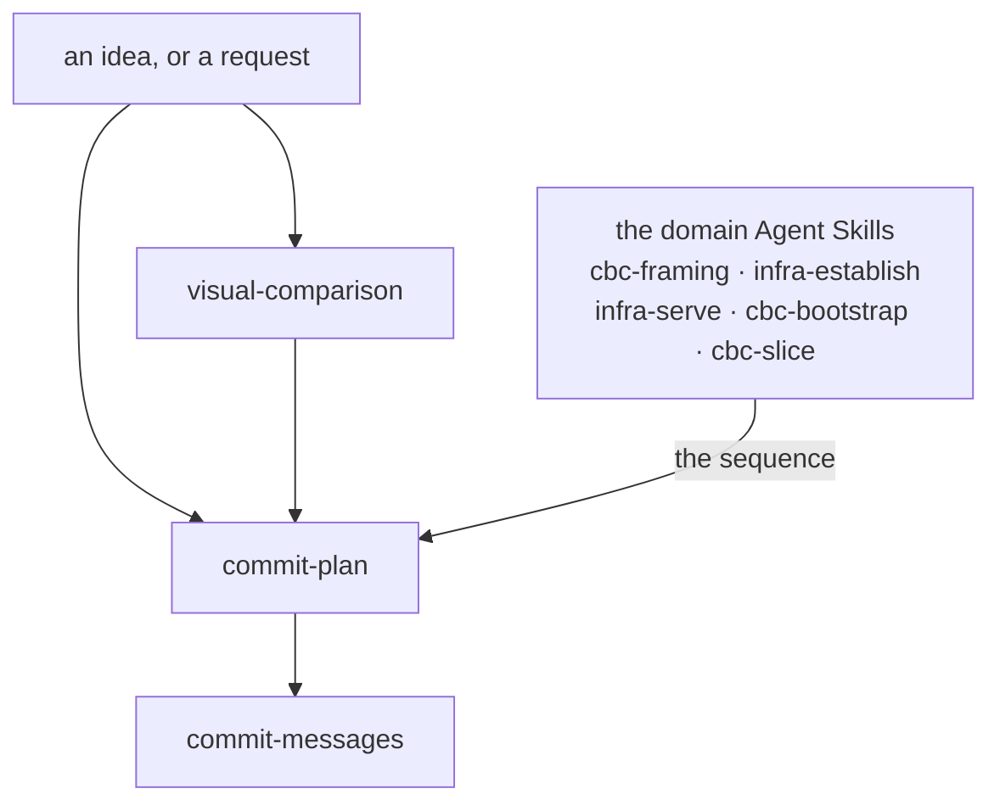

# Conventions

A Local Map (`docs/conventions/project-recording/` §8.6, *Local Maps*): how the conventions that act in sequence
during a piece of work hand to each other, from an idea to committed
work. The others relate through what they govern, read or describe,
and each states those relations in its manual's *What this does not
cover*. Which conventions there are and what each covers is
`ARCHITECTURE.md`'s (§1.2, *The conventions*).
What a convention is, how one is written and how one is added is
`docs/conventions/conventions/`.

## The chain

**Relations only** — every rule lives in a manual or an Agent Skill, and
nothing here restates one (ADR-0032).

**Each fires at its own moment; the arrows say what hands to what,
not what you must pass through.** A typo fix reaches only
`commit-messages`. A settled decision needing four commits reaches
only `commit-plan`. A question about how a diagram is drawn reaches
`visual-comparison` from wherever it arose.

**Work no Agent Skill or Agent Rule covers** starts from an Approach on Trial,
not from this chain: `.claude/approaches-on-trial/approach-drafting.md`.
Its work is planned like any other.

**The order *inside* a plan does not come from here.** It comes
from the domain Agent Skill that knows the work. That division is why
`commit-plan` stays generic and a project on another stack can use
it unchanged.

**What the chain produces** is not on it: an ADR for a decision
with rejected options, a `temp/` draft for a measurement or a
comparison, and the commits themselves. The other conventions, and
the records they govern, are not stages of this and fire on their
own moments.
