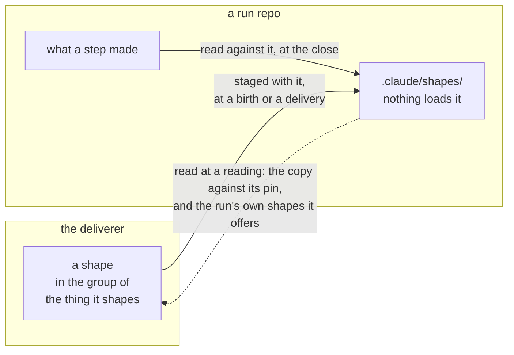
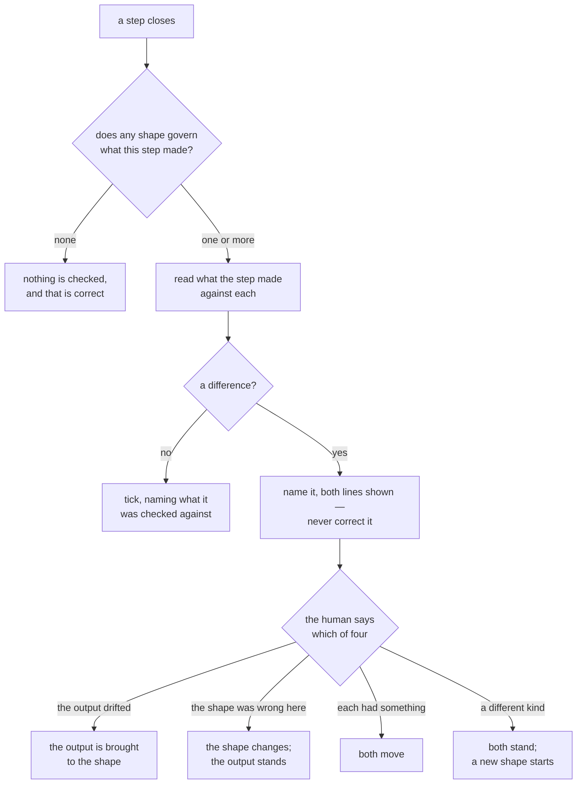

# Shapes

**What a kind of output looks like, in whichever repository makes
it: its form, never its content.**

## What it is for

So that what a kind of output looks like is written down once, from
work that exists, and read against the next output of its kind —
instead of each output re-deriving the form, or a template being
filled in. The failure is lived: CBC Run 3 made a thing this repo's
vocabulary had no word for, and it was called a template, a
specification, a convention and trial evidence before it got its
own (§2, *What an Output Shape is not*; ADR-0035, 2026-09-23). Made a convention, with this page
as its manual, on 2026-09-27 (ADR-0037): the Agent Rule binds, and this
page is why the Agent Rule is as it is, so that "why is this a
directory and not a rules file?" has an answer that is not
archaeology.

*Its story: ADR-0052; devlog 2026-10-29, the lessons' own stories: six places.*

## What this is made usable as

- **`delivery/container/.claude/rules/shapes-lifecycle.md` — the
  Agent Rule, shipped**, held at `.claude/rules/shapes-lifecycle.md` and
  loading when a file under `.claude/shapes/` is touched (§1, *What an Output Shape is*; §3, *One place, read
  at the gate*; §4, *An Output Shape between repos*; §5, *Using an
  Output Shape*), from the CBC Run's Convention Seat, with the definition repeated because a
  CBC Run cannot open this page.
- **`delivery/method/.claude/shapes/` — the Method Group's Output Shapes,
  shipped**, held at `.claude/shapes/` and read at a Plan Step's closing
  gate: instances of this convention, each from a CBC Run's lived
  records, its illustration from the worked example (§4.2, *An Output Shape's two layers*).
- **`delivery/README.md` — it points**: one sentence on placement, and the rest here
  (§4, *An Output Shape between repos*).

What derives from this page is that list. A change here walks it;
a change forced in one of them is checked back against this page.

*Its story: devlog 2026-09-27, afternoon; devlog 2026-10-29, the lessons' own stories: the other manuals and the tiers model.*

## The seats

### The CBC Run's seat

A CBC Run holds the Agent Rule, and keeps its Output Shapes in `.claude/shapes/`,
read at a Plan Step's closing gate. It receives Output Shapes in its deliveries
as copies, and writes its own from work that exists. It offers what
it arrived at by keeping it and pointing at it from its backlog.

### The Concept Deliverer's seat

The Concept Deliverer makes outputs too — a Run Reading is one — and its Plan Steps
have gates (ADR-0057). Two of its own forms, a Run Reading's and a
manual's, are Agent Rules today, with a
Governs line, loaded when the file is read, not while a new one is
written (`docs/conventions/agent-arrangement/` §5.6, *Rules files*); whether they become Output Shapes read at a Plan Step's gate is the
TODO item "Decide whether our own forms become shapes". It holds the Output Shapes it
ships, each in the group of what it shapes (§4, *An Output Shape between repos*), and reads a CBC Run's
Output Shapes when a line under its *To the deliverer* offers them
(`docs/conventions/exchange/` §6.2, *A file the CBC Run wrote*).

## 1. What an Output Shape is

### 1.1 What an Output Shape says

An **Output Shape** says what a kind of output looks like: its form, never
its content. *Project*, below, is the shipped Agent Rule's word: whichever
repository makes the output — a CBC Run, or the Concept Deliverer.

The two halves matter equally. *Form* is what recurs — which parts a
record has, what each is for, what a worked example must contain.
*Never content* is what stops an Output Shape check turning into a review of
the work: an Output Shape can say a guarantee needs an example with real
numbers, and cannot say which numbers, or whether the guarantee is
any good.

An Output Shape says what an output looks like while it exists. When the
output opens, extends and closes is the owning convention's. An Output Shape
that restates it is a copy of that convention, and a copy that
repeats is what drifts.

*Its story: devlog 2026-09-26; devlog 2026-10-29, the lessons' own stories: the other manuals and the tiers model.*

### 1.2 How an Output Shape is born

An Output Shape is written from work that exists. Two ways one is born, and
neither ranks above the other: **it recurred**, so a pair is the
evidence and what they share is the Output Shape; or **it was judged worth
keeping**, so one piece was rebuilt until it read well and someone
decided that should hold beyond here. What is ruled out is an Output Shape
designed in advance from an idea of how work should go — everything
measured against it afterwards would be measuring the guess.

### 1.3 An Output Shape's examples

An Output Shape's examples are read side by side,
for where they differ and for what they could all do better. A
difference ends as one form for all, a variant the Output Shape names, or a
better form none had. A weakness every example shares never shows
by comparing them; it shows only when they are read against what
went wrong. The Output Shape is then tried on the examples it came from. An
Output Shape catches a part missing, not a part that lost half its meaning
(ADR-0052).

*Its story: devlog 2026-10-29, the lessons' own stories: the other manuals and the tiers model.*

## 2. What an Output Shape is not

An Output Shape has four near neighbours, easily taken for it. The
differences are the reason the entry exists.

- **Not a template.** A template's content is holes awaiting
  specifics, and you fill it in. An Output Shape is read *against* finished
  work. Filling an Output Shape in is the failure mode it warns about — the
  material that does not fit gets hidden as a completed form.
- **Not a specification.** A test can verify conformance to a
  specification. Nothing can test that a passage reads well, and a
  difference from an Output Shape is a question rather than a failure.
- **Not a convention.** Deviating from a convention owes an
  explanation. An Output Shape *wants* divergence: that is how it learns,
  and a difference may end with the Output Shape changing rather than the
  output.
- **Not trial evidence.** This is the one that will be got wrong,
  because both are kept from the writer and look alike. Their
  blindness runs opposite ways. Trial evidence is withheld **in
  order to stay** undelivered — a derivation that has seen it
  measures imitation instead of independence, so showing it destroys
  the measurement. An Output Shape is delivered, and kept out of view **only
  until the gate**, after which being read against the work is the
  entire point.

## 3. One place, read at the gate

An Output Shape lives in `.claude/shapes/`. Nothing loads it while the work
is written; it is read at the Plan Step's closing gate.

The reason is what an Output Shape is for. Work written without it in
view can show that the Output Shape is wrong, or that a new one is needed;
work written to the Output Shape can only conform to it. So the first
output of a kind, which nothing here has yet influenced, is read
against the Output Shape rather than written from it.

What must hold while the work is written is not an Output Shape. It belongs
to the skill or the Agent Rule that runs the work. And where an Output Shape names
a part only the work can produce — a backstop "seen at the red run"
can only be known by looking during the red run — the skill that
runs the work asks for it too. Otherwise the gate finds the part
missing when it is too late to produce.

*Its story: ADR-0052.*

## 4. An Output Shape between repos

Stated here once; `delivery/README.md` points here. Inside a project, where an Output Shape lives is said above (§3, *One place,
read at the gate*). Between repositories, an Output Shape follows the group of the
thing it shapes — the same rule by which a skill belongs to exactly
one group and travels whole. A slice record's Output Shape is `method/`; a
Spring harness file's is `spring-postgres/`; a devlog entry's or a
commit plan's is `container/`. A CBC Run on another stack receives the
first and never the second, and that falls out of the groups rather
than being enforced on top of them.

An Output Shape travels as a copy, at birth and at every delivery, under the
one Delivery Pin that covers every delivered copy
(`docs/conventions/exchange/` §2.2, *The CBC Run*). A CBC Run edits a delivered Output Shape
as it edits any copy, and offers its own as it offers any file it
wrote.

### 4.1 Nothing fetched

A project fetches nothing (`docs/models/tiers.md` §3.5, *What holds on every flow*,
fact 1): what arrives,
arrives because it was staged with a delivery, by the reviewer or
by the agent when told (`docs/conventions/exchange/` §3.1, *Delivery Staging*). Nothing is
staged for a gate on its own. *Named in ADR-0037 as a third act of
the exchange, and never built: CBC Run 3 looked in `temp/` at two
closes and found nothing either time. With Output Shapes in the delivery,
nothing was left for it to carry.*

### 4.2 An Output Shape's two layers

An Output Shape is written in two layers. The skeleton and what it encodes are
general by construction: they say *a worked example with real numbers
from this system*, not which numbers. The illustrations filling the
placeholders are the project's, and are marked as such. A reader takes
the first and leaves the second, and nothing has to be rewritten at
the hand-off to make that possible. This is why the Agent Rule asks a
project to mark its illustrations apart.

An Output Shape the Concept Deliverer ships carries an illustration from the Method Group's
worked example, never a CBC Run's: the next CBC Run may be the same problem,
and a CBC Run's illustration is its answer.

### 4.3 Birth and delivery, drawn

Where an Output Shape sits at the Concept Deliverer, and how it reaches a CBC Run. Every
arrow that crosses is a delivery, staged by the reviewer or by the
agent when told.

This page's pictures illustrate its prose and never carry a fact
alone: read where Mermaid does not render, the page loses the
pictures and no facts.

*Its story: devlog 2026-09-27, afternoon; devlog 2026-10-29, the lessons' own stories: the other manuals and the tiers model.*

**The dashed line back is a Run Reading, and the difference in the line
is the point.** The traffic model — nothing sent upward, nothing
fetched, the Concept Deliverer reading a CBC Run and never the reverse — is the
Tiers Model's (`docs/models/tiers.md` §3.5, *What holds on every flow*), and the Run Reading is
the Exchange Convention's (`docs/conventions/exchange/` §6, *Up from the CBC Run*). What is this
convention's is
where the Run Reading looks: at `.claude/shapes/`, for the delivered
copies against their Delivery Pin and for the CBC Run's own Output Shapes, when a
backlog line offers them.

What travels upward is a **finding**, never a proposal: one project
saying what it arrived at — and it travels by being *read*, not by
being sent. What must not travel is a CBC Run's answer as the next
CBC Run's standard: the skeleton travels, the illustration is the
Method Group's (§4.2, *An Output Shape's two layers*).

## 5. Using an Output Shape

### 5.1 Use, drawn

What a gate does when a Plan Step closes: find which Output Shapes govern what
was made, read, and settle each difference. One ending is easy to
misread as a gap and is plainly an ending here: "no Output Shape governs
this" means nothing is checked, and that is correct.

### 5.2 A tick, and a difference

A gate reads what a Plan Step made against every Output Shape governing it, and
**what it ticks records what it checked against** — including that
nothing governed, which is an answer rather than an omission. A tick
with no note is what would be wrong.

The comparison is by judgment, not by text: does the output have
the parts the Output Shape names, in its order, reading as it says? A
difference is **named, never corrected**: the line from the output
and the line from the Output Shape, side by side. That is the whole guard
against an Output Shape check becoming a review of the work: the gate says
where two things differ, and a human says what that means. It ends
one of four ways, decided per difference and never by a policy of
preferring one side: **the output drifted**, so it is brought to the
Output Shape; **the Output Shape was wrong here**, so it changes and the output
stands; **each had something**, and both move; or **the output is a
different kind**, so both stand and a new Output Shape starts from it (§1.2, *How an Output Shape is born*).
Any change is shown before it is made.

Outputs closed before a change are not reopened — each looks like
what the Output Shape asked for when it was written, and the difference
between them records when the Output Shape changed.

**An Output Shape that never changes is either finished or unread.**

## Why it arrives this way

The first convention with no skill: its artifact is an Agent Rule, because
the moment it serves is an Output Shape being touched, and an Agent Rule loads on the
path (`docs/models/agent.md` §4.3, *pushed*). The Output Shapes themselves reach no
agent while work is written, by design — nothing loads
`.claude/shapes/`, and that is their force (§3, *One place, read at the gate*).

## What this does not cover

- **When an output opens, extends and closes** — the convention
  that owns the output; an Output Shape that restates it is a copy of that
  convention (§1.1, *What an Output Shape says*).
- **How an Agent Rule loads** — `docs/conventions/agent-arrangement/` §5.6, *Rules files*.
- **What passes between repositories, and how** —
  `docs/conventions/exchange/`.
- **The gate items that make a project meet an Output Shape at a Plan Step's
  close** — whatever defines the project's Plan Steps; for a CBC Run born
  from the Concept Deliverer, `delivery/fills/cbc-run-pure-playbook.md`.
- **Whether `docs/baselines/` holds anything that is an Output Shape
  rather than trial evidence** — this page draws the line (§2, *What an
  Output Shape is not*); the sorting
  against it is its own work, not yet done.
