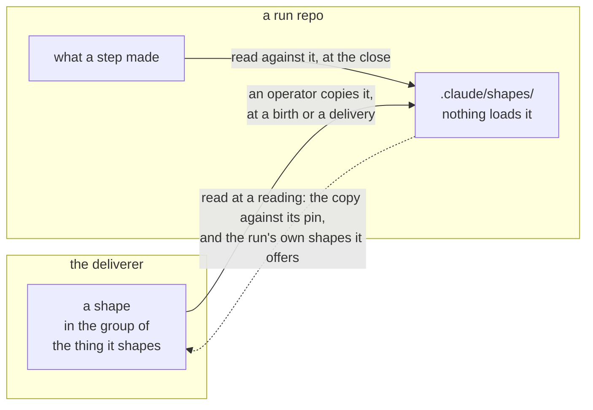
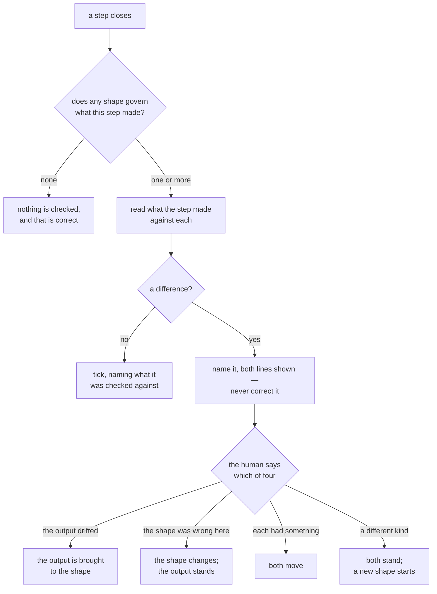

# Shapes

**What a kind of output looks like, in whichever repository makes
it — its form, never its content — written from work that exists,
and read at a step's closing gate and nowhere else.**

## What it is for

So that what a kind of output looks like is written down once, from
work that exists, and read against the next output of its kind —
instead of each output re-deriving the form, or a template being
filled in. The failure is lived: run 3 made a thing this repo's
vocabulary had no word for, and it was called a template, a
specification, a convention and trial evidence before it got its
own (§2; ADR-0035, 2026-09-23). Made a convention, with this page
as its manual, on 2026-09-27 (ADR-0037): the rule binds, and this
page is why the rule is the shape it is, so that "why is this a
directory and not a rules file?" has an answer that is not
archaeology.

*Reshaped 2026-10-15 from run 3's retrospective (ADR-0052): the page
had held two places, the place deciding the force, and a staging
act for one of them. Run 3 lived both places and kept one; the
staging was never used on either side.*

## What this is made usable as

- **`delivery/container/.claude/rules/shapes-lifecycle.md` — the
  rule, shipped**, held at `.claude/rules/shapes-lifecycle.md` and
  loading when a file under `.claude/shapes/` is touched. §1, §3,
  §4 and §5, from the run's seat, with the definition repeated because a
  run cannot open this page.
- **`delivery/method/.claude/shapes/` — the method's shapes,
  shipped**, held at `.claude/shapes/` and read at a step's closing
  gate: instances of this convention, each from a run's lived
  records, its illustration from the worked example (§4.2).
- **`delivery/README.md` — a pointer**: one sentence on placement,
  and §4 for the rest.

What derives from this page is that list. A change here walks it;
a change forced in one of them is checked back against this page.

*Does the name hold? Every section is about a shape — what one is,
where it sits, how it travels, what a difference with one means. It
held, 2026-09-27, and again 2026-10-15.*

## The seats

### The run's seat

A run holds the rule, and keeps its shapes in `.claude/shapes/`,
read at a step's closing gate. It receives shapes in its deliveries
as copies, and writes its own from work that exists. It offers what
it arrived at by keeping it and pointing at it from its backlog.

### The deliverer's seat

The deliverer makes outputs too — a reading is one — and its steps
have gates since ADR-0057. Its own forms are rules today, with a
Governs line, loaded while the file is written; whether they become
shapes read at a step's gate is open (TODO). It holds the shapes it
ships, each in the group of what it shapes (§4), and reads a run's
shapes when it reads the run.

## 1. What a shape is

A **shape** says what a kind of output looks like: its form, never
its content. *Project*, below, is the master's word: whichever
repository makes the output — a run, or the deliverer.

The two halves matter equally. *Form* is what recurs — which parts a
record has, what each is for, what a worked example must contain.
*Never content* is what stops a shape check turning into a review of
the work: a shape can say a guarantee needs an example with real
numbers, and cannot say which numbers, or whether the guarantee is
any good.

*Found twice on 2026-09-26. A shape says what an output looks like
while it exists; when the output opens, extends and closes is the
owning convention's, and a shape that restates it is a copy of that
convention, and a copy that repeats is what drifts. The reading's
shape here restated the reading's lifecycle in its first section and
lost the sentences rather than gaining a clause; run 3's
`slice-record.md` opens with a section on how it is used that says
the same thing from its side. The rule now says it in one sentence.*

A shape is written from work that exists. Two ways one is born, and
neither ranks above the other: **it recurred**, so a pair is the
evidence and what they share is the shape; or **it was judged worth
keeping**, so one piece was rebuilt until it read well and someone
decided that should hold beyond here. What is ruled out is a shape
designed in advance from an idea of how work should go — everything
measured against it afterwards would be measuring the guess.

**Before a shape is written, its examples are read side by side**,
for where they differ and for what they could all do better. A
difference ends as one form for all, a variant the shape names, or a
better form none had. A weakness every example shares never shows
by comparing them; it shows only when they are read against what
went wrong. The shape is then tried on the examples it came from.
*Run 3, 2026-10-13: none of the twenty kills in its definition had a
worked example with numbers, so a kill shape copied from them would
never have asked for one. Tried on the definition before a fix, the
shape found the two kills that had lost their whole death, and not
the two that had kept a weaker one: a shape catches a part missing,
not a part that lost half its meaning (ADR-0052).*

## 2. What a shape is not

The vocabulary already had four near neighbours, and a shape was
called each of them at some point before it got its own word. The
differences are the reason the entry exists.

- **Not a template.** A template's content is holes awaiting
  specifics, and you fill it in. A shape is read *against* finished
  work. Filling a shape in is the failure mode it warns about — the
  material that does not fit gets hidden as a completed form.
- **Not a specification.** A test can verify conformance to a
  specification. Nothing can test that a passage reads well, and a
  difference from a shape is a question rather than a failure.
- **Not a convention.** Deviating from a convention owes an
  explanation. A shape *wants* divergence: that is how it learns,
  and a difference may end with the shape changing rather than the
  output.
- **Not trial evidence.** This is the one that will be got wrong,
  because both are kept from the writer and look alike. Their
  blindness runs opposite ways. Trial evidence is withheld **in
  order to stay** undelivered — a derivation that has seen it
  measures imitation instead of independence, so showing it destroys
  the measurement. A shape is delivered, and kept out of view **only
  until the gate**, after which being read against the work is the
  entire point.

## 3. One place, read at the gate

A shape lives in `.claude/shapes/`. Nothing loads it while the work
is written; it is read at the step's closing gate.

The reason is what a shape is for. Work written without the shape in
view can show that the shape is wrong, or that a new one is needed;
work written to the shape can only conform to it. So the first
output of a kind, which nothing here has yet influenced, is read
against the shape rather than written from it.

What must hold while the work is written is not a shape. It belongs
to the skill or the rule that runs the work. And where a shape names
a part only the work can produce — a backstop "seen at the red run"
can only be known by looking during the red run — the skill that
runs the work asks for it too. Otherwise the gate finds the part
missing when it is too late to produce.

*Until 2026-10-15 a shape had two places, and the place was its
force: under `.claude/rules/` with `paths:` it loaded while the work
was written. Run 3 lived both. Its evidence-test shape loaded from
SL-3, and SL-4's tests followed it; at its retrospective its
reviewer moved every shape to the gate, for the reason above, and
named gate-only a trial for run 4's second slice to judge. A test
written without the shape in view is the measurement this repo had
held that shape back for (ADR-0052).*

## 4. Where a shape lives, between repositories

Stated here once; `delivery/README.md` points here. Inside a
project, §3. Between repositories, a shape follows the group of the
thing it shapes — the same rule by which a skill belongs to exactly
one group and travels whole. A slice record's shape is `method/`; a
Spring harness file's is `spring-postgres/`; a devlog entry's or a
commit plan's is `container/`. A run on another stack receives the
first and never the second, and that falls out of the groups rather
than being enforced on top of them.

A shape travels as a copy, at birth and at every delivery, under the
one pin that covers the skills and rules
(`docs/conventions/exchange/` §3.2). A run edits a delivered shape
as it edits any copy, and offers its own as it offers any file it
wrote.

### 4.1 A project fetches nothing

Nothing is fetched (`docs/conventions/exchange/` §1): what arrives,
arrives because a person staged it with a delivery. Nothing is
staged for a gate on its own. *Named in ADR-0037 as a third act of
the exchange, and never built: run 3 looked in `temp/` at two
closes and found nothing either time. With shapes in the delivery,
nothing was left for it to carry.*

### 4.2 Two separable layers, and only one travels well

A shape is written in two layers. The skeleton and what it encodes are
general by construction: they say *a worked example with real numbers
from this system*, not which numbers. The illustrations filling the
placeholders are the project's, and are marked as such. A reader takes
the first and leaves the second, and nothing has to be rewritten at
the hand-off to make that possible. This is why the rule asks a
project to mark its illustrations apart.

A shape the deliverer ships carries an illustration from the method's
worked example, never a run's: the next run may be the same problem,
and a run's illustration is its answer.

### 4.3 Birth and delivery, drawn

Where a shape sits at the deliverer, and how it reaches a run. Every
arrow that crosses is carried by a person.

*This page's pictures illustrate its prose and never carry a fact
alone. Measured 2026-09-27 and found false: five claims lived only
in a chart. The prose grew to cover them; read where Mermaid does not
render, this page loses the pictures and no facts.*

**The dashed line back is a reading, and the difference in the line
is the point.** The traffic model — nothing sent upward, nothing
fetched, the deliverer reading a run and never the reverse — is
`docs/conventions/exchange/` §1 and §6. What is this convention's is
where the reading looks: at `.claude/shapes/`, for the delivered
copies against their pin and for the run's own shapes, when a
backlog line offers them.

What travels upward is a **finding**, never a proposal: one project
saying what it arrived at — and it travels by being *read*, not by
being sent. What must not travel is a run's answer as the next
run's standard: the skeleton travels, the illustration is the
method's (§4.2).

## 5. How a shape is used, and what a difference means

### 5.1 Use, drawn

What a gate does when a step closes: find which shapes govern what
was made, read, and settle each difference. One ending is easy to
misread as a gap and is plainly an ending here: "no shape governs
this" means nothing is checked, and that is correct.

### 5.2 A tick, and a difference

A gate reads what a step made against every shape governing it, and
**what it ticks records what it checked against** — including that
nothing governed, which is an answer rather than an omission. A tick
with no note is what would be wrong.

The comparison is by judgment, not by text: does the output have
the parts the shape names, in its order, reading as it says? A
difference is **named, never corrected**: the line from the output
and the line from the shape, side by side. That is the whole guard
against a shape check becoming a review of the work: the gate says
where two things differ, and a human says what that means. It ends
one of four ways, decided per difference and never by a policy of
preferring one side: **the output drifted**, so it is brought to the
shape; **the shape was wrong here**, so it changes and the output
stands; **each had something**, and both move; or **the output is a
different kind**, so both stand and a new shape starts from it (§1).
Any change is shown before it is made.

Outputs closed before a change are not reopened — each looks like
what the shape asked for when it was written, and the difference
between them records when the shape changed.

**A shape record that never changes is either finished or unread.**

## Why it arrives this way

The first convention with no skill: its artifact is a rule, because
the moment it serves is a shape being touched, and a rule loads on
the path. The shapes themselves reach no agent while work is
written, by design — nothing loads `.claude/shapes/`, and that is
their force (§3).

## What this does not cover

- **When an output opens, extends and closes** — the convention
  that owns the output; a shape that restates it is a copy of that
  convention (§1).
- **How a rule loads** — `docs/conventions/agent-arrangement/` §3.2.
- **What passes between repositories, and how** —
  `docs/conventions/exchange/`.
- **The gate items that make a project meet a shape at a step's
  close** — whatever defines the project's steps; for a run born
  from the deliverer, `delivery/fills/cbc-run-pure-playbook.md`.
- **Whether `docs/baselines/` holds anything that is a shape
  rather than trial evidence** — §2 draws the line; the sorting
  against it is its own work, not yet done.
