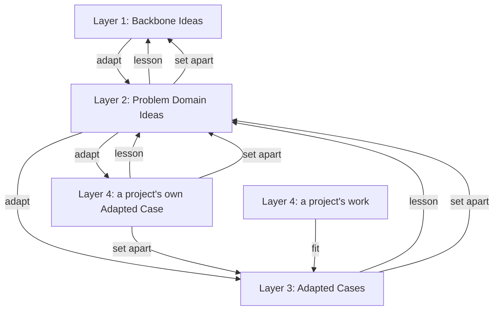

# How Change's arrows are shown: a visual comparison

<!-- A visual comparison's draft (.claude/skills/visual-comparison/SKILL.md), commit 8i of the commit plan for the Change split. It settles how Change, knowledge/backbone-ideas/change.md, shows its arrows, now that the layers picture draws only what is where (ADR-0088, decision 8). It goes once the outcome is recorded, in the commit that places the winner. -->

## 1. The defect

The layers picture no longer draws how knowledge moves. Change's arrows are now only a list, Change §4, *The arrows*: four items, each naming its layers in words. Whether a reader gets from it where knowledge moves, and which way, is the question. A form that answers it no better than the list loses to the list.

## 2. What the reader must get

Each is stated so a candidate can fail it.

1. **The four arrows by name:** adapt, lesson, set apart, fit.
2. **Each arrow's layers,** from and to, every pair Change §4 gives, a project's own Adapted Case's included: adapt also from layer 2 to a project's own at layer 4; lesson also from it to layer 2; set apart also from layer 4 to layer 3, and from a project's own to layer 2.
3. **Which way each goes:** adapt down; lesson, set apart and fit up.
4. **What moves on each,** in a few words: adapt, a text written from the idea above; lesson, what work taught, as high as it is true; set apart, a part true without what its text adds; fit, the work fitting the Adapted Case to what happened.
5. **That *worked by* is not one of them:** it is what layer 4 holds, the layers of knowledge's.
6. **Nothing redrawn from the layers picture:** what each layer holds is not drawn again (ADR-0088, the rejected option of a picture repeating the layers picture).

## 3. The candidates

Each is built whole. A is today's form, where "nothing wins" lands.

### Candidate A: today's list

- **adapt,** layer 1 to layer 2, and layer 2 to layer 3, or to layer 4 for a project's own Adapted Case: a text is written from the idea above it, narrowed to its need, with what the need adds. A part left out on purpose is marked, with why (§4's **Rules**, *Narrowing, never shrinking*).
- **lesson,** layer 3 to layer 2, layer 2 to layer 1, and a project's own Adapted Case in layer 4 to layer 2: a lesson goes up as far as it is true (§3).
- **set apart,** layer 3 to layer 2, layer 2 to layer 1, and layer 4 to layer 3, or to layer 2 from a project's own Adapted Case: while a text is written, a part of it shows as true without what the text adds. The part is written in the layer above, and the text is then adapted from it.
- **fit,** layer 4 to layer 3: where the work shows the Adapted Case does not fit, the work fits it to what happened. Where no Adapted Case covers the work, the project writes its own, on trial (`knowledge/backbone-ideas/layers-of-knowledge.md` §3.4, *The layer of work*). The change is judged, and goes up the arrow *lesson* as far as it holds.

The arrow *worked by*, layer 3 to layer 4, is the layers of knowledge's: it is what layer 4 holds, not a change (`knowledge/backbone-ideas/layers-of-knowledge.md` §3.4, *The layer of work*).

### Candidate B: a table

| Arrow | Way | Layers | What moves |
|---|---|---|---|
| adapt | down | 1 to 2; 2 to 3; 2 to a project's own Adapted Case, at 4 | a text written from the idea above, narrowed to its need |
| lesson | up | 3 to 2; 2 to 1; a project's own Adapted Case to 2 | what the work taught, as far up as it is true |
| set apart | up | 3 to 2; 2 to 1; 4 to 3; a project's own Adapted Case to 2 | a part true without what its text adds, written in the layer above |
| fit | up | 4 to 3 | the work fitting the Adapted Case to what happened |

The arrow *worked by*, layer 3 to layer 4, is the layers of knowledge's: it is what layer 4 holds, not a change.

### Candidate C: a box-drawing picture

```
                       ┌──────────────────────────────┐
 Layer 1               │ Backbone Ideas               │
                       └──────────────────────────────┘
                          │        ▲          ▲
                        adapt   lesson    set apart
                          ▼        │          │
                       ┌──────────────────────────────────────────────────────────────────────────────────┐
 Layer 2               │ Problem Domain Ideas                                                             │
                       └──────────────────────────────────────────────────────────────────────────────────┘
                          │        ▲          ▲                                 │        ▲         ▲
                        adapt   lesson    set apart                           adapt   lesson   set apart
                          ▼        │          │                                 │        │         │
                       ┌────────────────────────────────────────────────┐       │        │         │
 Layer 3               │ Adapted Cases                                  │       │        │         │
                       └────────────────────────────────────────────────┘       │        │         │
                                   ▲                              ▲             │        │         │
                                  fit                         set apart         │        │         │
                                   │                              │             ▼        │         │
                                   │                        ┌─────────────────────────────────────────────┐
 Layer 4               a project's work                     │ a project's own Adapted Case                │
                                                            └─────────────────────────────────────────────┘
```

Key: each box names a layer's texts, never what they hold, which is the layers of knowledge's picture. The arrow *worked by*, layer 3 to layer 4, is not drawn: it is the layers of knowledge's, not a change.

### Candidate D: a Mermaid flowchart



Key: as C's. Its syntax is plain flowchart syntax; no renderer was run here.

## 4. The verdicts

Each turns on a requirement of §2. Every verdict on how a candidate looks is a prediction until the reviewer has rendered it.

| Requirement | A, list | B, table | C, box drawing | D, Mermaid |
|---|---|---|---|---|
| 1. the four by name | holds | holds | holds | holds |
| 2. every pair of layers | holds, in words | holds, one cell each | holds, each pair an arrow | holds, each pair an edge |
| 3. which way | holds, by "layer 1 to layer 2" | holds, its own column | holds, by the arrowheads | holds, by the arrowheads; prediction: the layout may set layer 4 beside layer 3, as the render of 2026-11-23 set layer 1 beside layer 2 |
| 4. what moves | holds | holds, a few words each | fails: no room on an arrow, so the key or §4 must say it | fails, as C |
| 5. *worked by* not one | holds, its own line | holds, its own line | holds, by the key | holds, by the key |
| 6. nothing redrawn | holds | holds | holds: names only | holds: names only |

Prediction: B holds every requirement, and adds a view by arrow over A. C shows the shape best, a project's own Adapted Case's routes beside the main column, but fails 4 and so needs §4 beside it. D fails 4, and its layout is not in its writer's hands.
