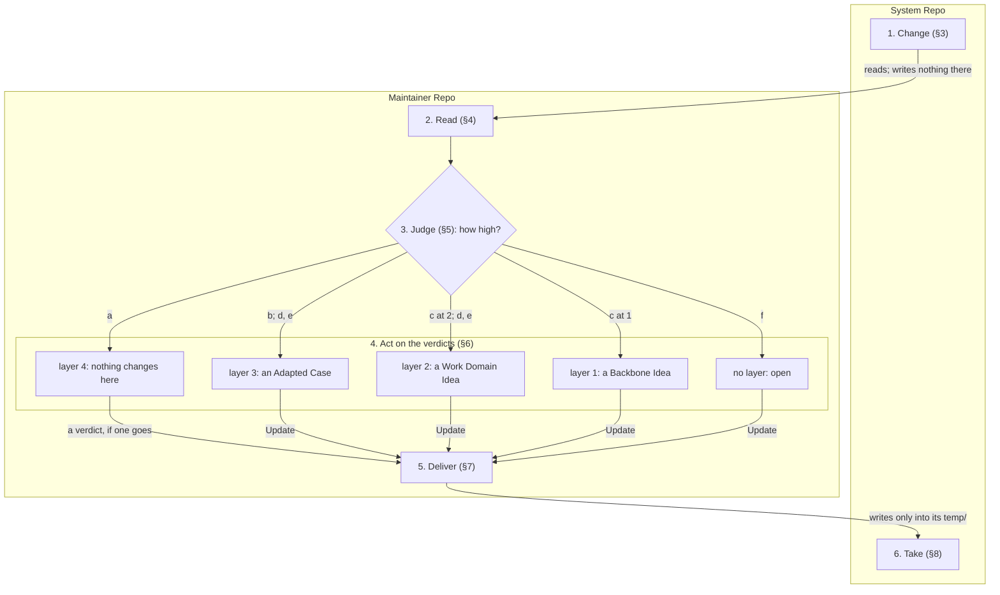

# Change Whole, a Comparison

<!-- A draft of the visual-comparison Agent Skill, for the TODO item
     "Draw Change whole". It settles how Change's six parts and its
     depths are shown together. Its facts are the simulation's,
     temp/common-ground/system-repo-change-simulation.md, never its
     own. It goes once the outcome is recorded, and git keeps it. -->

The simulation follows a System Repo's Change through six parts, and seven depths say how high a Change goes. Each part's rules sit in its own steps, §3 to §8, and the depths sit in §2's table. No page shows them together. This draft finds the form that does.

It uses the simulation's short words: Change, Copy, Update (`temp/common-ground/system-repo-change-simulation.md`, its table at the top). A § alone is the simulation's.

## 1. What the reader must get

Written before any candidate was built. Each is stated so a candidate can fail it.

1. **R1, the parts in order:** Change, Read, Judge, Act on the verdicts, Deliver, Take.
2. **R2, who does each:** the System Repo or the Maintainer Repo.
3. **R3, what crosses:** Read only reads the System Repo, and writes nothing there. Deliver writes only into the System Repo's `temp/`.
4. **R4, how high each depth goes:** for depths a to f, the highest layer it changes, from layer 4 down to "no layer".
5. **R5, where a depth is set and where it acts:** Judge sets it, Act on the verdicts changes that layer, and Deliver brings it down, or nothing comes down.
6. **R6, what is open:** what the simulation leaves open is marked open, and nothing decides it. Depths b to f are not yet checked against the steps (§2).
7. **R7, where to read more:** each part and each depth points at its section, so the form holds no fact of its own.

Two limits:

- **Not the flow drawing:** no commits, no main (`temp/common-ground/system-repo-change-flow.md`).
- **Not the layers picture:** not where each layer is kept (`temp/common-ground/knowledge-layers.md` §1, *The picture*).

## 2. The candidates

### 2.1 What exists

Four tables in two files, read together:

- the simulation's parts table, §1, *How it is worked*: each part, who does it, its steps;
- the simulation's cases table, §2, *The cases*: each depth, with its layer and its status;
- the layers document's two tables, `temp/common-ground/knowledge-layers.md` §3.2, *How a Change moves*: each part's place in the picture, and the arrows each depth travels.

Not copied here: they stand where they are.

### 2.2 One table

| Depth | Highest layer | 1. Change, System Repo (§3) | 2. Read, Maintainer Repo, writes nothing there (§4) | 3. Judge, Maintainer Repo (§5) | 4. Act on the verdicts, Maintainer Repo (§6) | 5. Deliver, only into `temp/` (§7) | 6. Take, System Repo (§8) |
|---|---|---|---|---|---|---|---|
| a. it stays in the System Repo | 4 | a Copy changed, with its Record | each Change listed, nothing judged | its own, question 2 | nothing changes | a verdict, if one goes down | the Copy keeps its Change |
| b. the System Kit's Adapted Case changes; not yet checked | 3 | the same | the same | a lesson for its Adapted Case | the System Kit's Adapted Case changes | an Update | this Copy already has it |
| c, at layer 2. its Work Domain Idea changes; not yet checked | 2 | the same | the same | a lesson for its Work Domain Idea, question 4a | the Work Domain Idea changes, after the survey | an Update | not yet checked |
| c, at layer 1. its Backbone Idea changes; not yet checked | 1 | the same | the same | a lesson for its Backbone Idea, question 4b | the Backbone Idea changes, after the survey; how far down it reaches is open | an Update | not yet checked |
| d. the idea above already holds it; not yet checked | 3, or 2 | the same | the same | lost in narrowing, question 3 | the Adapted Case fixed from the idea above; at layer 2, the Work Domain Idea first | an Update | not yet checked |
| e. it asks to narrow the idea above; not yet checked | 3, or 2 | the same | the same | no verdict for it yet; open | the narrowing marked, with its why, in the text just below | an Update | not yet checked |
| f. several Adapted Cases need it, but not all; not yet checked | none, open | the same | the same | no verdict for it yet; open | open | an Update | not yet checked |

### 2.3 A numbered list

1. **Change**, in the System Repo (§3): a Copy changed, with its Record; the Plan Step's gate decides each.
2. **Read**, by the Maintainer Repo (§4): it reads the System Repo and writes nothing there, and lists each Change, judging nothing.
3. **Judge**, by the Maintainer Repo (§5): it sets the depth, the highest layer the Change goes to (§2):
   - a. it stays in the System Repo: layer 4;
   - b. the System Kit's Adapted Case changes: layer 3; not yet checked;
   - c, at layer 2. its Work Domain Idea changes: layer 2; not yet checked;
   - c, at layer 1. its Backbone Idea changes: layer 1; not yet checked;
   - d. the idea above already holds it: layer 3, or layer 2; not yet checked;
   - e. it asks to narrow the idea above: layer 3, or layer 2; not yet checked;
   - f. several Adapted Cases need it, but not all: no layer, open; not yet checked.
4. **Act on the verdicts**, by the Maintainer Repo (§6): it changes the layer the depth names; for depth a, nothing.
5. **Deliver**, by the Maintainer Repo (§7): an Update, written only into the System Repo's `temp/`, and only when it carries something; for depth a, a verdict, if one goes down.
6. **Take**, in the System Repo (§8): at the next Plan Step's opening.

### 2.4 Unicode box drawing

```
 System Repo  ┆ Maintainer Repo
 ───────────  ┆ ───────────────
              ┆
 1. Change ───┼── reads; writes nothing there ──▶ 2. Read ──▶ 3. Judge ──▶ 4. Act on the verdicts
    §3        ┆                                      §4          §5           §6
              ┆                                                               │
 6. Take ◀────┼── writes only into its temp/ ──── 5. Deliver ◀────────────────┘
    §8        ┆                                      §7

 How high each depth goes: 3. Judge sets it, 4. Act on the verdicts changes it (§2)

 depth                          a           b        c, at 2   c, at 1   d         e         f
                                            └──────────────── not yet checked ────────────────┘
 layer 1  Backbone Idea                                        ●
 layer 2  Work Domain Idea                           ●         ●         ○         ○
 layer 3  Adapted Case                      ●        ●         ●         ●         ●
 layer 4  a System Repo's work  ●           ●        ●         ●         ●         ●         ●
 ───────────────────────────────────────────────────────────────────────────────────────────────────────
 highest layer                  4           3        2         1         3, or 2   3, or 2   none, open
 5. Deliver brings down         a verdict,  Update   Update    Update    Update    Update    Update
                                if one goes
```

Key: ● is the Change's path, from its Copy up to the highest layer it changes. ○ is "or up to here", when the case asks it (§2, rows d and e). The last row follows the layers document's arrows (`temp/common-ground/knowledge-layers.md` §3.2, *How a Change moves*). A § is the simulation's section.

### 2.5 Mermaid flowchart



## 3. The verdicts

Each verdict is read from the raw Markdown, as the IDE shows it. One marked *prediction* was not rendered: the Mermaid renderer was refused, since it runs Chrome with its sandbox turned off, and GitHub's table render was not looked at.

| | 2.1 What exists | 2.2 One table | 2.3 Numbered list | 2.4 Box drawing | 2.5 Mermaid |
|---|---|---|---|---|---|
| **R1, order** | pass, the parts table | pass, the columns | pass | pass, the loop | pass, *prediction* |
| **R2, who** | pass, the parts table | pass, the headers | pass | pass, the two lanes | pass, the subgraphs, *prediction* |
| **R3, what crosses** | fail: no table says it | pass, the headers | pass | pass, the two crossing arrows | pass, the edge labels, *prediction* |
| **R4, how high** | pass, the cases table | pass | pass | pass, the ladder and its row | fail, *prediction*: Mermaid places the five layer nodes side by side in its own order, so no ladder shows |
| **R5, set and acts** | pass, the layers document's first table | pass | pass | pass, the ladder's title and its last row | pass, *prediction* |
| **R6, what is open** | fail: the layers document's tables do not mark b to f not yet checked | fail: building it found the gap. A full table asks for a cell for every part at every depth, and the simulation has checked only depth a. Of the 56 cells, 12 say "the same" and 5 say "not yet checked" | pass | pass, the bracket and the last column | fail: "d, e" on two edges says both, where the simulation says one or the other; and "not yet checked" has no place but six more labels |
| **R7, read more** | pass: they are the homes | pass | pass | pass, a § at each part | pass |
| **The defect** | fail: four tables in two files, the defect itself | holds, but 8 columns: each raw row runs 168 to 254 characters | fixed | fixed | fixed, *prediction* |

## 4. The outcome

**Two pass every requirement: the numbered list and the box drawing.** The other three fail at least one:

- **What exists** fails R3 and R6, and is the defect itself.
- **One table** fails R6: its shape demands a cell where the simulation has no answer yet.
- **Mermaid** fails R4 and R6, by prediction.

**The tie, and how it is broken:** no requirement written first separates the two. The agent's recommendation is the box drawing, for two things the list only says:

- the path's shape: the list gives the order, while the loop shows the Change leaving the System Repo and coming back;
- the heights side by side: the list gives seven lines to compare, while the ladder shows them at once, with the "or" of d and e and depth f's gap in plain view.

These were not written down before building, so they are a judgment, for the reviewer's word. The TODO item also asks for one picture.

**Where it lands, recommended:** the end of the simulation's §2, under a bold lead, as a summary that says so and points at its sections. The rejected places:

- **The flow drawing:** its §1 checks every drawing for commits and main, and this one fails those by design;
- **A file of its own:** one more draft in `temp/` to keep in step with the simulation.

**How the outcome is recorded:** one line in the session's devlog entry, as case A's comparison was, with no ADR. Then this draft goes.
