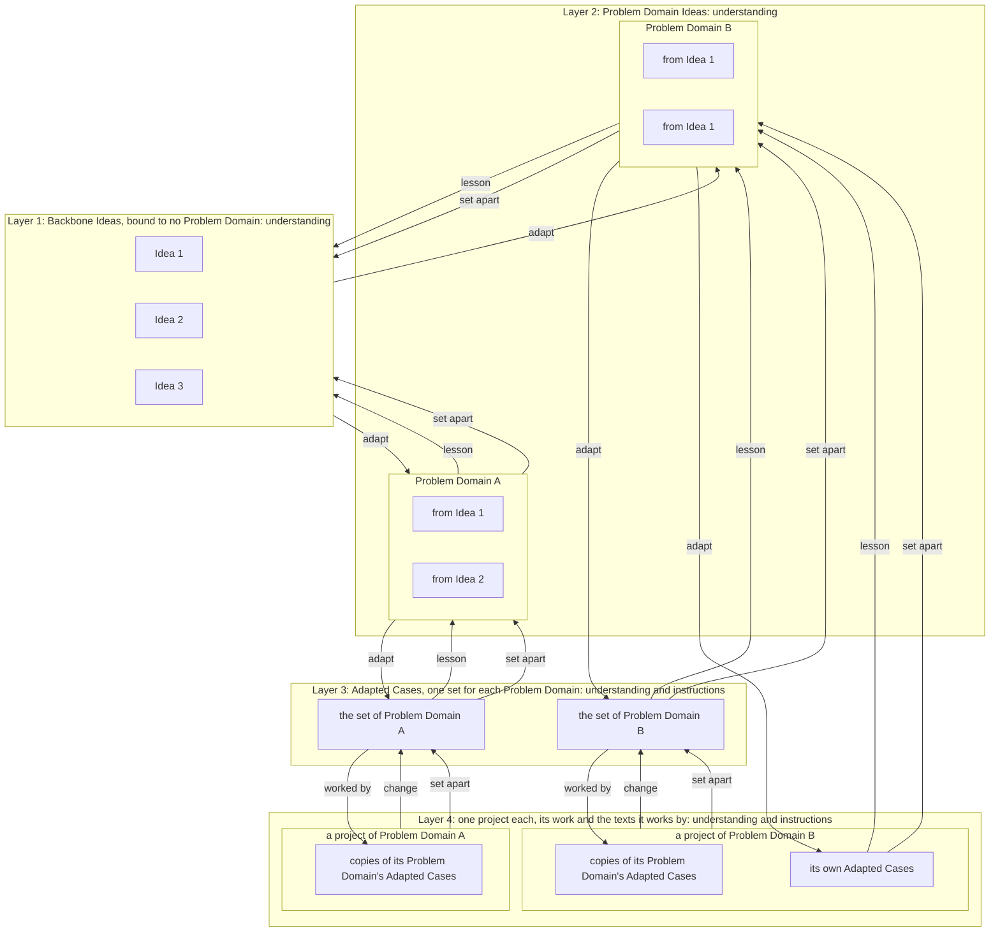

# How the general layers picture is shown, compared

<!-- A visual comparison's draft (.claude/skills/visual-comparison/SKILL.md).
     It settles how temp/common-ground/knowledge-layers-general.md §1, The
     picture, shows layers 2 to 4 grouped by Problem Domain: commit 4m of
     COMMIT-PLAN.md. The outcome is recorded in the body of the commit
     that places it in the general document, and this draft goes in that
     commit. -->

## 1. The defect

The text now groups layers 2 and 3 by Problem Domain, and makes layer 4 one project (`temp/common-ground/knowledge-layers-general.md` §2.2, §2.3, §2.4). The picture does not:

- **Layer 2** is one box, "Each Problem Domain", with three Problem Domain Ideas in it. Which Problem Domain each belongs to cannot be seen, so §2.2's "the picture's Idea 1" adapted twice "in the same Problem Domain" is not shown.
- **Layer 3** is one box, "one set for each Problem Domain". No set sits under the Problem Domain whose ideas it is written from (§2.3).
- **Layer 4** is one box, "One project". It does not show a project's copies apart from its own Adapted Cases, or that each project is of one Problem Domain (§2.4).

The picture was relabelled word for word in 4i and 4k (`99d02486`, `9d4c67d3`); its shape is from before the grouping.

## 2. What the reader must get

1. **G1, the four layers:** their order, layer 1 at the top; layers 1 and 2 hold understanding, layers 3 and 4 understanding and instructions (§2).
2. **G2, layer 2 by Problem Domain:** each Problem Domain Idea belongs to one Problem Domain, and names the Backbone Idea it is from. Two Problem Domains that need the same Backbone Idea each write their own adaptation; none is shared (§2.2).
3. **G3, layer 3 by Problem Domain:** one set of Adapted Cases for each Problem Domain, written from that Problem Domain's own ideas, so a set stands under its own Problem Domain's ideas (§2.3).
4. **G4, layer 4 as projects:** each project is of one Problem Domain, and works by its copies of that Problem Domain's Adapted Cases and by its own Adapted Cases, written where none of its Problem Domain's covers a piece of its work (§2.4).
5. **G5, the arrows,** each between the layers §3.2 names, and no others:
   - *adapt:* 1 to 2; 2 to 3; 2 to a project's own Adapted Case in 4;
   - *lesson:* 3 to 2; 2 to 1; a project's own Adapted Case in 4 to 2;
   - *set apart:* 3 to 2; 2 to 1; 4 to 3; a project's own Adapted Case in 4 to 2;
   - *worked by:* 3 to 4;
   - *change:* 4 to 3.
6. **G6, what the text says of the picture stays true:** Ideas 1, 2 and 3 stand under several, one and no Problem Domain Ideas (§2.1); Idea 1 is adapted more than once in the same Problem Domain (§2.2). The Key may change with the picture.
7. **G7, no real Problem Domain:** the document gives no example from one Problem Domain's work (its header), so the picture names none.

Built under the skill's constraint: Mermaid or Unicode box drawing (§2, step 4). The general picture is 68 columns today, the Maintainer Repo's 91.

## 3. The candidates

- **A.** One Unicode picture, by layer: layers 2, 3 and 4 each split into a box per Problem Domain, two Problem Domains.
- **B.** One Unicode picture, by Problem Domain: layer 1 across the top, then a column per Problem Domain running down through layers 2, 3 and 4.
- **C.** A Mermaid flowchart, a subgraph per layer, and inside layers 2 to 4 a subgraph per Problem Domain.
- **D.** A table, no picture: a row per layer, a column per Problem Domain, the arrows left to §3.2.
- **E.** Nothing new: today's picture, as it stands.

Every candidate draws two Problem Domains, A and B. Problem Domain A adapts Ideas 1 and 2; Problem Domain B adapts Idea 1 twice. So Ideas 1, 2 and 3 stand under three, one and no Problem Domain Ideas, and Idea 1 is adapted twice in one Problem Domain (G6). Only Problem Domain B's project has its own Adapted Case, so the arrows for one are drawn once.

### Candidate A, by layer

```
          ┌─────────────────────────────────────────────────────────────────────────────┐
          │ Backbone Ideas, bound to no Problem Domain:                                 │
          │ understanding                                                               │
 Layer 1  │   ┌──────────┐          ┌──────────┐          ┌──────────┐                  │
          │   │ Idea 1   │          │ Idea 2   │          │ Idea 3   │                  │
          │   └──────────┘          └──────────┘          └──────────┘                  │
          └─────────────────────────────────────────────────────────────────────────────┘
                │      ▲       ▲          │      ▲       ▲
              adapt lesson set apart    adapt lesson set apart
                ▼      │       │          ▼      │       │
          ┌─────────────────────────────────────────────────────────────────────────────┐
          │ Problem Domain Ideas: understanding                                         │
          │ ┌──────────────────────┐  ┌───────────────────────────────────────────────┐ │
          │ │ Problem Domain A     │  │ Problem Domain B                              │ │
          │ │ ┌───────────────┐    │  │ ┌───────────────┐  ┌───────────────┐          │ │
          │ │ │ from Idea 1   │    │  │ │ from Idea 1   │  │ from Idea 1   │          │ │
 Layer 2  │ │ └───────────────┘    │  │ └───────────────┘  └───────────────┘          │ │
          │ │ ┌───────────────┐    │  │                                               │ │
          │ │ │ from Idea 2   │    │  │                                               │ │
          │ │ └───────────────┘    │  │                                               │ │
          │ └──────────────────────┘  └───────────────────────────────────────────────┘ │
          └─────────────────────────────────────────────────────────────────────────────┘
                │      ▲       ▲          │      ▲       ▲         │      ▲       ▲
              adapt lesson set apart    adapt lesson set apart   adapt lesson set apart
                ▼      │       │          ▼      │       │         │      │       │
          ┌────────────────────────────────────────────────────┐   │      │       │
          │ Adapted Cases, one set for each Problem Domain:    │   │      │       │
          │ understanding and instructions                     │   │      │       │
          │ ┌──────────────────────┐  ┌──────────────────────┐ │   │      │       │
 Layer 3  │ │ the set of           │  │ the set of           │ │   │      │       │
          │ │ Problem Domain A     │  │ Problem Domain B     │ │   │      │       │
          │ └──────────────────────┘  └──────────────────────┘ │   │      │       │
          └────────────────────────────────────────────────────┘   │      │       │
              │        ▲       ▲          │        ▲       ▲       │      │       │
          worked by change set apart  worked by change set apart   │      │       │
              ▼        │       │          ▼        │       │       ▼      │       │
          ┌─────────────────────────────────────────────────────────────────────────────┐
          │ One project each: its work, and the texts it works by:                      │
          │ understanding and instructions                                              │
          │ ┌──────────────────────┐  ┌───────────────────────────────────────────────┐ │
          │ │ a project of         │  │ a project of Problem Domain B:                │ │
          │ │ Problem Domain A:    │  │ ┌───────────────────┐  ┌────────────────────┐ │ │
 Layer 4  │ │ copies of its        │  │ │ copies of its     │  │ its own            │ │ │
          │ │ Problem Domain's     │  │ │ Problem Domain's  │  │ Adapted Cases      │ │ │
          │ │ Adapted Cases        │  │ │ Adapted Cases     │  │                    │ │ │
          │ │                      │  │ └───────────────────┘  └────────────────────┘ │ │
          │ └──────────────────────┘  └───────────────────────────────────────────────┘ │
          └─────────────────────────────────────────────────────────────────────────────┘
```

Key: each Problem Domain Idea names the Backbone Idea it is from (§2.2). The arrows on the right serve the project's own Adapted Case, written where none of its Problem Domain's covers a piece of its work (§2.4). Problem Domain A's project has none.

### Candidate B, by Problem Domain

```
          ┌───────────────────────────────────────────────────────────────────────────────────┐
          │ Backbone Ideas, bound to no Problem Domain:                                       │
          │ understanding                                                                     │
 Layer 1  │   ┌──────────┐            ┌──────────┐            ┌──────────┐                    │
          │   │ Idea 1   │            │ Idea 2   │            │ Idea 3   │                    │
          │   └──────────┘            └──────────┘            └──────────┘                    │
          └───────────────────────────────────────────────────────────────────────────────────┘
                │      ▲       ▲                │      ▲       ▲
                │      │       │                │      │       │
              adapt lesson set apart          adapt lesson set apart
          ┌╌╌╌╌╌│╌╌╌╌╌╌│╌╌╌╌╌╌╌│╌╌╌╌╌╌╌┐  ┌╌╌╌╌╌│╌╌╌╌╌╌│╌╌╌╌╌╌╌│╌╌╌╌╌╌╌╌╌╌╌╌╌╌╌╌╌╌╌╌╌╌╌╌╌╌╌╌╌╌┐
          ╎     ▼      │       │       ╎  ╎     ▼      │       │                              ╎
          ╎ ┌────────────────────────┐ ╎  ╎ ┌───────────────────────────────────────────────┐ ╎
          ╎ │ Problem Domain Ideas:  │ ╎  ╎ │ Problem Domain Ideas: understanding           │ ╎
          ╎ │ understanding          │ ╎  ╎ │                                               │ ╎
          ╎ │ ┌───────────────┐      │ ╎  ╎ │ ┌───────────────┐  ┌───────────────┐          │ ╎
 Layer 2  ╎ │ │ from Idea 1   │      │ ╎  ╎ │ │ from Idea 1   │  │ from Idea 1   │          │ ╎
          ╎ │ └───────────────┘      │ ╎  ╎ │ └───────────────┘  └───────────────┘          │ ╎
          ╎ │ ┌───────────────┐      │ ╎  ╎ │                                               │ ╎
          ╎ │ │ from Idea 2   │      │ ╎  ╎ │                                               │ ╎
          ╎ │ └───────────────┘      │ ╎  ╎ │                                               │ ╎
          ╎ └────────────────────────┘ ╎  ╎ └───────────────────────────────────────────────┘ ╎
          ╎     │      ▲       ▲       ╎  ╎     │      ▲       ▲        │      ▲       ▲      ╎
          ╎   adapt lesson set apart   ╎  ╎   adapt lesson set apart  adapt lesson set apart  ╎
          ╎     ▼      │       │       ╎  ╎     ▼      │       │        │      │       │      ╎
          ╎ ┌────────────────────────┐ ╎  ╎ ┌──────────────────────┐    │      │       │      ╎
          ╎ │ Adapted Cases:         │ ╎  ╎ │ Adapted Cases:       │    │      │       │      ╎
 Layer 3  ╎ │ understanding and      │ ╎  ╎ │ understanding and    │    │      │       │      ╎
          ╎ │ instructions           │ ╎  ╎ │ instructions         │    │      │       │      ╎
          ╎ └────────────────────────┘ ╎  ╎ └──────────────────────┘    │      │       │      ╎
          ╎     │        ▲       ▲     ╎  ╎     │        ▲       ▲      │      │       │      ╎
          ╎ worked by change set apart ╎  ╎ worked by change set apart  │      │       │      ╎
          ╎     ▼        │       │     ╎  ╎     ▼        │       │      ▼      │       │      ╎
          ╎ ┌────────────────────────┐ ╎  ╎ ┌───────────────────────────────────────────────┐ ╎
          ╎ │ a project: its work,   │ ╎  ╎ │ a project: its work, by understanding and     │ ╎
          ╎ │ by copies of its       │ ╎  ╎ │ instructions:                                 │ ╎
          ╎ │ Problem Domain's       │ ╎  ╎ │ ┌───────────────────┐  ┌────────────────────┐ │ ╎
          ╎ │ Adapted Cases:         │ ╎  ╎ │ │ copies of its     │  │ its own            │ │ ╎
 Layer 4  ╎ │ understanding and      │ ╎  ╎ │ │ Problem Domain's  │  │ Adapted Cases      │ │ ╎
          ╎ │ instructions           │ ╎  ╎ │ │ Adapted Cases     │  │                    │ │ ╎
          ╎ │                        │ ╎  ╎ │ └───────────────────┘  └────────────────────┘ │ ╎
          ╎ └────────────────────────┘ ╎  ╎ └───────────────────────────────────────────────┘ ╎
          ╎ Problem Domain A           ╎  ╎ Problem Domain B                                  ╎
          └╌╌╌╌╌╌╌╌╌╌╌╌╌╌╌╌╌╌╌╌╌╌╌╌╌╌╌╌┘  └╌╌╌╌╌╌╌╌╌╌╌╌╌╌╌╌╌╌╌╌╌╌╌╌╌╌╌╌╌╌╌╌╌╌╌╌╌╌╌╌╌╌╌╌╌╌╌╌╌╌╌┘
```

Key: each dashed frame holds one Problem Domain: its ideas, its set of Adapted Cases, and a project of it. Each Problem Domain Idea names the Backbone Idea it is from (§2.2). The arrows on the right serve the project's own Adapted Case (§2.4). Problem Domain A's project has none.

### Candidate C, Mermaid



### Candidate D, a table

| Layer | Problem Domain A | Problem Domain B |
|---|---|---|
| 1, understanding | Backbone Ideas, bound to no Problem Domain: Idea 1, Idea 2, Idea 3 | the same Backbone Ideas |
| 2, understanding | Problem Domain Ideas: from Idea 1; from Idea 2 | Problem Domain Ideas: from Idea 1; from Idea 1 |
| 3, understanding and instructions | the set of Adapted Cases of Problem Domain A | the set of Adapted Cases of Problem Domain B |
| 4, understanding and instructions | a project of Problem Domain A: copies of its Problem Domain's Adapted Cases | a project of Problem Domain B: copies of its Problem Domain's Adapted Cases; its own Adapted Cases |

The arrows are left to §3.2.

### Candidate E, nothing new

Today's picture and Key, as they stand in `temp/common-ground/knowledge-layers-general.md` §1, *The picture*. Not copied here.

## 4. The verdicts

Each verdict on the look is the agent's prediction until the reviewer has rendered the candidate where it will be read. C's was rendered once by `mmdc`, locally.

| | A | B | C | D | E |
|---|---|---|---|---|---|
| **G1** the four layers | holds: each layer's frame names its kind of text once | holds: rows by layer, the kind repeated in each box | **fails** in the `mmdc` render: layer 1 sits beside layer 2, and Problem Domain B above A | holds | holds |
| **G2** layer 2 by Problem Domain | holds | holds | holds | holds | **fails**: one box, no Problem Domain |
| **G3** a set under its ideas | holds, by column | holds, by frame and column | holds, though the set's arrows run far | holds, by column | **fails**: one box |
| **G4** projects, copies and own | holds | holds | holds | holds | **fails**: one project, copies and own in one line |
| **G5** the arrows | holds | holds | holds, tangled | **fails**: no arrows | holds |
| **G6** the text's claims | holds | holds | holds | holds | Idea 1 twice "in the same Problem Domain" is not shown |
| **G7** no real Problem Domain | holds | holds | holds | holds | holds |
| Size | 89 columns, 48 rows | 95 columns, 44 rows | an image | a table | 68 columns, 41 rows |

Found while building:

- **B's frame says two things.** In the Maintainer Repo's picture, a frame says where texts are kept: the dotted one the Maintainer Repo, the dashed one the System Kit. In B, a dashed frame says which Problem Domain. A reader of both documents meets one mark with two meanings.
- **C needs the layout fought** to put layer 1 on top: invisible links or nodes declared out of order. By the skill's §4, *Using a dialect is not fighting it*, it has lost.
- **A's layer 4 frame holds two projects,** while §2.4 says layer 4 "is one project". A's frame label says "One project each" to keep it true; B has no layer frame to say it.
