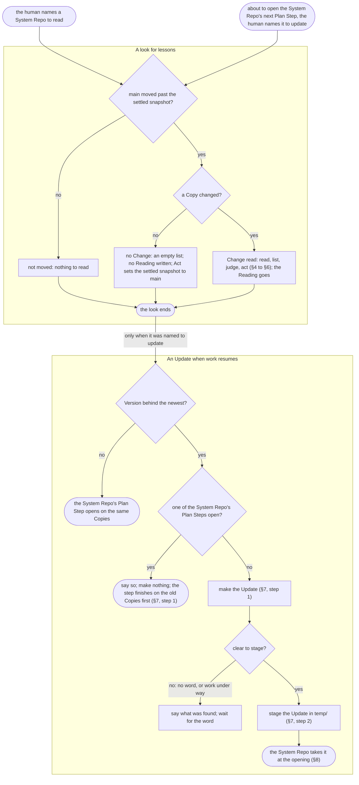

# A System Repo's Change, as a Flow

<!-- A draft of the knowledge work (ADR-0082). It pictures the System Repo's commits in the round of
     temp/common-ground/system-repo-change-simulation.md, and the part acting on
     each, and the Maintainer Repo's choices. The facts live in the
     simulation, never here. "Now" pictures the simulation as it is.
     Each "After" section pictures one open decision, one drawing per
     option, each named by its option. When the decision is made, the
     simulation changes, the chosen option's drawing becomes "Now",
     and that "After" section goes. It goes once what it holds has
     landed in the rewrite into the layers model, and git keeps every
     version. -->

It uses the simulation's short forms: Change, Record, Copy, Update, Update Note, Take, Version, Reading, Register (`temp/common-ground/system-repo-change-simulation.md`, its table at the top).

## 1. What the reader must get

Each drawing is checked against these.

1. **R1, the order:** every step of one round, from a Change to the System Repo's next Plan Step opening.
2. **R2, the repo:** which repo each step happens in.
3. **R3, what crosses:** a Reading only reads the System Repo, and writes nothing there. An Update is written only into the System Repo's `temp/`.
4. **R4, where main moves:** each place main moves.
5. **R5, what a Reading compares:** the two snapshots each Reading compares.
6. **R6, what is open:** each part not decided is marked open, and nothing decides it.

## 2. Now

**Key,** for every commit picture below:

- **commits:** imaginary commits of the System Repo, oldest first, top to bottom.
- **main, branches:** a step's or a Take's branch is cut from main, to its right. At its gate's close, main moves to the branch's last commit by fast-forward: a commit named again on main is no new commit.
- **Maintainer Repo:** a bracket joins the two snapshots a Reading compares: its top is the older, the *settled snapshot* or, after a Take, the *version snapshot*, and its bottom is the stop. The commits between are history, opened only to understand something deeper. A Reading writes nothing in the System Repo. A bracket closes when the verdicts are acted on, and its stop becomes the *settled snapshot*. The *settled snapshot* is not a Take. The Maintainer Repo's parts stand between the commits, since it makes none.
- **System Repo:** its parts, each pointing at the commit it acts on.
- **┊:** no commit.

### The two jobs

What the Maintainer Repo does with one System Repo, drawn as its choices, in two jobs, each in its own box. A look for lessons runs when the human names the System Repo to read, and ends once Act is done (`temp/common-ground/system-repo-change-simulation.md` §4, step 1, *A look at main*). An Update when work resumes runs when the human, about to open the System Repo's next Plan Step, names it to update: the look runs first, then Deliver's check (`temp/common-ground/system-repo-change-simulation.md` §7, step 1, *When one is due*). A look ends in one of three cases: *not moved*, *no Change* and *Change read* (`temp/common-ground/system-repo-change-simulation.md` §4, step 1, *A look at main*). Each step names its section of the simulation.



### The Take

The System Repo takes an Update at the opening of the System Repo's next Plan Step, on a branch of its own (`temp/common-ground/system-repo-change-simulation.md` §8, step 1). It is drawn once, here; each case that ends in an Update points at it. "Item" names an item of §8's *At the Take, in order*.

```
 Maintainer Repo                                   main      branches                               System Repo
 ───────────────                                   ────      ────────                               ───────────
 ── before ─────────────────────────────────────────┼───────────────────────────────────────────────────────────
                         settled snapshot ─▶     c1 ●  the last gate closed                   ◀──── the Copies at Version 1; the System Kit has since reached Version 2
                                                    ┊                                         ┄┄┄┄┄ an Update waits in temp/, staged by Deliver (§7), not yet in force: every Copy
                                                    ┊                                               at Version 2, and an Update Note naming c1, the settled snapshot it was built against
                                                    │
 ── the check ──────────────────────────────────────┼───────────────────────────────────────────────────────────
                                                    ┊                                         ┄┄┄┄┄ at the opening of the System Repo's next Plan Step, the Take checks first, from the Update Note:
                                                    ┊                                               case 1, main is still c1, the settled snapshot: the Update is taken, below
                                                    ┊                                               case 2, anything else: no Take; the System Repo says so, and the human names it to update again
                                                    │
 ── the Take ───────────────────────────────────────┼───────────────────────────────────────────────────────────
                                                    ├─ cut ──────┐                            ◀──── the Take's branch, cut from c1
                                                    │            │
                                                    │         c2 ●  the Update, as it arrived ◀──── committed in temp/, not yet in force: a record of what came
                                                    │            │
                                                    │         c3 ●  the new Adapted Case      ◀──── item 1: for taking, at Version 2, put in first; it runs the rest
                                                    │            ┊                            ┄┄┄┄┄ item 2: the files checked against the Update Note; no commit
 c4, the version snapshot: the next look            │         c4 ●  every Copy at Version 2   ◀──── item 3: Copies taken whole, each path gone removed, each renamed moved; every Record cleared
 compares from here                                 │            │
                                                    │         c5 ●  Version 2 recorded        ◀──── item 4: with the commit that holds it, c4; open: where in the System Repo Version 2 and c4 are written (§8, Open)
                                                    │            │
                                                    │         c6 ●  the Update removed        ◀──── item 5: the Update and the Update Note leave temp/
                                                    │            │
                                                    │         c7 ●  the gate closes           ◀──── item 6: the gate checks that the Take finished
                                                    │            │
                                                 c7 ● ◀──────────┘                            ◀──── main moves to c7 by fast-forward, at the gate's close
                                                    │
 ── after ──────────────────────────────────────────┼───────────────────────────────────────────────────────────
                                                    └─ cut ──────┐                            ◀──── the System Repo's next Plan Step opens on Version 2
                                                                 │
                                                              c8 ●  work, on Version 2
```

### A look's cases

A look at main makes two checks, and with Deliver's check, whether an Update is due, ends in one of five cases: A, B, C1, C2 and D2 (`temp/common-ground/system-repo-change-simulation.md` §4, step 1, *A look at main*). Each case is drawn on its own. Three lines split each picture into before, now and after. Now holds the Maintainer Repo's parts, in the simulation's order: Read Changes, with the look and its case, Judge, Act on the verdicts and Deliver. The System Repo's parts, a Change and the Take, stand in before and after. The examples are pure, as the simulation is: every Change is taken into the System Kit (`temp/common-ground/system-repo-change-simulation.md` §2, *Known, not ruled*). Above each picture, a table gives that example's answers to the look's checks; check 2 is asked only when main moved, so A and B show "—". What defines each case is the simulation's table.

#### Case A, nothing follows

| Main moved | Copy changed | Version behind | What follows |
|---|---|---|---|
| no | — | no | nothing |

```
 Maintainer Repo                                   main      branches                               System Repo
 ───────────────                                   ────      ────────                               ───────────
 ── before ─────────────────────────────────────────┼───────────────────────────────────────────────────────────
 read and acted on                            ┌  c0 ●  earlier steps and Takes                ◀──── history
                                              │     │
 settled snapshot: the last Reading's stop ─▶ └  c1 ●  the last gate closed                   ◀──── the Copies at Version 1, the newest
                                                    │
 ── now ────────────────────────────────────────────┼───────────────────────────────────────────────────────────
 before the System Repo's next Plan Step, the       ┊
 human has the Maintainer Repo look at it           ┊
 (§8, Before the Take):                             ┊
 Read Changes (§4):                                 ┊
   the look at main (§4, step 1):                   ┊
   check 1: main is c1, the settled snapshot.       ┊
   Main has not moved: nothing to read              ┊
   gives: the stop, c1, and an empty list           ┊
 Judge (§5): gives no verdicts                      ┊
 Act on the verdicts (§6): nothing to act on;       ┊
   the settled snapshot set to the stop, c1,        ┊
   as it was                                        ┊
 Deliver (§7):                                      ┊
   is an Update due? The Version is the             ┊
   newest: case A.                                  ┊
   What follows: nothing                            ┊
   none, nothing to send                            ┊
                                                    │
 ── after ──────────────────────────────────────────┼───────────────────────────────────────────────────────────
                                                    └─ cut ──────┐                            ◀──── step 2 opens on Version 1
                                                                 │
                                                             c2 ●  work, on Version 1         ◀──── it reaches main at its gate; the next look sees it
```

#### Case B, an Update follows

| Main moved | Copy changed | Version behind | What follows |
|---|---|---|---|
| no | — | yes | an Update |

```
 Maintainer Repo                                   main      branches                               System Repo
 ───────────────                                   ────      ────────                               ───────────
 ── before ─────────────────────────────────────────┼───────────────────────────────────────────────────────────
 read and acted on                            ┌  c0 ●  earlier steps and Takes                ◀──── history
                                              │     │
 settled snapshot: the last Reading's stop ─▶ └  c1 ●  the last gate closed                   ◀──── the Copies at Version 1; the System Kit has since reached Version 2
                                                    │
 ── now ────────────────────────────────────────────┼───────────────────────────────────────────────────────────
 before the System Repo's next Plan Step, the       ┊
 human has the Maintainer Repo look at it           ┊
 (§8, Before the Take):                             ┊
 Read Changes (§4):                                 ┊
   the look at main (§4, step 1):                   ┊
   check 1: main is c1, the settled snapshot.       ┊
   Main has not moved: nothing to read              ┊
   gives: the stop, c1, and an empty list           ┊
 Judge (§5): gives no verdicts                      ┊
 Act on the verdicts (§6): nothing to act on;       ┊
   the settled snapshot set to the stop, c1,        ┊
   as it was                                        ┊
 Deliver (§7):                                      ┊
   is an Update due? The Version is 1, and          ┊
   the newest is 2: case B. What follows:           ┊
   an Update is made and delivered                  ┊
   makes the Update: every Copy at Version 2,       ┊
   and an Update Note for Copies at Version 1       ┊
   stages it in the System Repo's temp/             ┊
                                                    │
 ── after ──────────────────────────────────────────┼───────────────────────────────────────────────────────────
                                                    ├─ cut ──────┐                            ◀──── the Take (§8), once it checks: main is still c1, the settled snapshot
                                                    │            │
                                                    │         c2 ●  the Update, as it arrived ◀──── the Take's commits, as drawn in The Take, above
                                                    │            │                            ◀──── c3 to c6, not drawn
                                                    │         c7 ●  the gate closes           ◀──── the Take's gate checks that the Take finished, and closes
                                                    │            │
                                                 c7 ● ◀──────────┘                            ◀──── main moves to c7 by fast-forward, at the gate's close
                                                    │
                                                    └─ cut ──────┐                            ◀──── step 2 opens on Version 2
                                                                 │
                                                              c8 ●  work, on Version 2
```

#### Case C1, nothing to read

| Main moved | Copy changed | Version behind | What follows |
|---|---|---|---|
| yes | no | no | the settled snapshot moves up to main; nothing else |

```
 Maintainer Repo                                   main      branches                               System Repo
 ───────────────                                   ────      ────────                               ───────────
 ── before ─────────────────────────────────────────┼───────────────────────────────────────────────────────────
 read and acted on                            ┌  c0 ●  earlier steps and Takes                ◀──── history
                                              │     │
 settled snapshot: the last Reading's stop ─▶ └  c1 ●  the last gate closed                   ◀──── the Copies at Version 1, the newest
                                                    │
                                                    ├─ cut ──────┐                            ◀──── step 1 opens on Version 1
                                                    │            │
                                                    │         c2 ●  work, no Copy changed
                                                    │            │
                                                    │         c3 ●  the gate closes           ◀──── the gate (§3, step 2): no Change to decide; it closes
                                                    │            │
                                                 c3 ● ◀──────────┘                            ◀──── main moves to c3 by fast-forward, no new commit
                                                    │
 ── now ────────────────────────────────────────────┼───────────────────────────────────────────────────────────
 before the System Repo's next Plan Step, the       ┊
 human has the Maintainer Repo look at it           ┊
 (§8, Before the Take):                             ┊
 Read Changes (§4):                                 ┊
   the look at main (§4, step 1):                   ┊
   check 1: main is c3, past the settled            ┊
   snapshot, c1. Main has moved                     ┊
   check 2: c1 against c3: no Copy changed:         ┊
   nothing to read                                  ┊
   gives: the stop, c3, and an empty list           ┊
 Judge (§5): gives no verdicts                      ┊
 Act on the verdicts (§6): nothing to act on;       ┊
   the settled snapshot set to the stop, c3         ┊
 Deliver (§7):                                      ┊
   is an Update due? The Version is the             ┊
   newest: case C1.                                 ┊
   What follows: nothing else                       ┊
   none, nothing to send                            ┊
                                                    │
 ── after ──────────────────────────────────────────┼───────────────────────────────────────────────────────────
                                                    └─ cut ──────┐                            ◀──── step 2 opens on Version 1
                                                                 │
                                                              c4 ●  work, on Version 1        ◀──── the next look compares c3, the settled snapshot, with main
```

#### Case C2, an Update follows

| Main moved | Copy changed | Version behind | What follows |
|---|---|---|---|
| yes | no | yes | the settled snapshot moves up to main; an Update |

```
 Maintainer Repo                                   main      branches                               System Repo
 ───────────────                                   ────      ────────                               ───────────
 ── before ─────────────────────────────────────────┼───────────────────────────────────────────────────────────
 read and acted on                            ┌  c0 ●  earlier steps and Takes                ◀──── history
                                              │     │
 settled snapshot: the last Reading's stop ─▶ └  c1 ●  the last gate closed                   ◀──── the Copies at Version 1; the System Kit has since reached Version 2
                                                    │
                                                    ├─ cut ──────┐                            ◀──── step 1 opens on Version 1
                                                    │            │
                                                    │         c2 ●  work, no Copy changed
                                                    │            │
                                                    │         c3 ●  the gate closes           ◀──── the gate (§3, step 2): no Change to decide; it closes
                                                    │            │
                                                 c3 ● ◀──────────┘                            ◀──── main moves to c3 by fast-forward, no new commit
                                                    │
 ── now ────────────────────────────────────────────┼───────────────────────────────────────────────────────────
 before the System Repo's next Plan Step, the       ┊
 human has the Maintainer Repo look at it           ┊
 (§8, Before the Take):                             ┊
 Read Changes (§4):                                 ┊
   the look at main (§4, step 1):                   ┊
   check 1: main is c3, past the settled            ┊
   snapshot, c1. Main has moved                     ┊
   check 2: c1 against c3: no Copy changed:         ┊
   nothing to read                                  ┊
   gives: the stop, c3, and an empty list           ┊
 Judge (§5): gives no verdicts                      ┊
 Act on the verdicts (§6): nothing to act on;       ┊
   the settled snapshot set to the stop, c3         ┊
 Deliver (§7):                                      ┊
   is an Update due? The Version is 1, and          ┊
   the newest is 2: case C2. What follows:          ┊
   an Update is made and delivered                  ┊
   makes the Update: every Copy at Version 2,       ┊
   and an Update Note for Copies at Version 1       ┊
   stages it in the System Repo's temp/             ┊
                                                    │
 ── after ──────────────────────────────────────────┼───────────────────────────────────────────────────────────
                                                    ├─ cut ──────┐                            ◀──── the Take (§8), once it checks: main is still c3, the settled snapshot
                                                    │            │
                                                    │         c4 ●  the Update, as it arrived ◀──── the Take's commits, as drawn in The Take, above
                                                    │            │                            ◀──── c5 to c8, not drawn
                                                    │         c9 ●  the gate closes           ◀──── the Take's gate checks that the Take finished, and closes
                                                    │            │
                                                 c9 ● ◀──────────┘                            ◀──── main moves to c9 by fast-forward, at the gate's close
                                                    │
                                                    └─ cut ──────┐                            ◀──── step 2 opens on Version 2
                                                                 │
                                                             c10 ●  work, on Version 2
```

#### Case D2, an Update follows

| Main moved | Copy changed | Version behind | What follows |
|---|---|---|---|
| yes | yes | yes, after acting | the Reading; an Update |

The example's Update brings back the System Repo's own lesson: depth b, the System Kit's Adapted Case changing (`temp/common-ground/system-repo-change-simulation.md` §2, the "how deep" rows). The Take is drawn in full, to show what it does with a Change Version 2 already holds.

```
 Maintainer Repo                                   main      branches                               System Repo
 ───────────────                                   ────      ────────                               ───────────
 ── before ─────────────────────────────────────────┼───────────────────────────────────────────────────────────
 read and acted on                            ┌  c0 ●  earlier steps and Takes                ◀──── history
                                              │     │
 settled snapshot: the last Reading's stop ─▶ └  c1 ●  the last gate closed                   ◀──── the Copies at Version 1, the newest
                                                    │
                                                    ├─ cut ──────┐                            ◀──── step 1 opens on Version 1
                                                    │            │
                                                    │         c2 ●  a Copy changed            ◀──── a Change, with its Record; its proposal: any repo would meet it
                                                    │            │
                                                    │         c3 ●  the gate closes           ◀──── the gate (§3, step 2): the Change kept; it closes
                                                    │            │
                                                 c3 ● ◀──────────┘                            ◀──── main moves to c3 by fast-forward, no new commit
                                                    │
 ── now ────────────────────────────────────────────┼───────────────────────────────────────────────────────────
 before the System Repo's next Plan Step, the       ┊
 human has the Maintainer Repo look at it           ┊
 (§8, Before the Take):                             ┊
 Read Changes (§4):                                 ┊
   the look at main (§4, step 1):                   ┊
   check 1: main is c3, past the settled            ┊
   snapshot, c1. Main has moved                     ┊
   check 2: c1 against c3: a Copy changed           ┊
   case D. What follows: the Reading                ┊
   the Reading: c1 compared with c3; one            ┊
   line, the Change with its Record                 ┊
   gives: the stop, c3, and a list of one line      ┊
 Judge (§5): one verdict: a lesson for its          ┊
   Adapted Case, depth b; the proposal holds        ┊
 Act on the verdicts (§6): the System Kit's         ┊
   Adapted Case gains the lesson, reworded:         ┊
   the System Kit reaches Version 2. The            ┊
   settled snapshot set to the stop, c3             ┊
 Deliver (§7):                                      ┊
   is an Update due? The Version is 1, and          ┊
   the newest is 2: case D2. What follows:          ┊
   an Update is made and delivered                  ┊
   makes the Update: every Copy at Version 2,       ┊
   and an Update Note for Copies at Version 1,      ┊
   giving the lesson as the why                     ┊
   stages it in the System Repo's temp/             ┊
                                                    │
 ── after ──────────────────────────────────────────┼───────────────────────────────────────────────────────────
                                                    ├─ cut ──────┐                            ◀──── the Take (§8), once it checks: main is still c3, the settled snapshot
                                                    │            │
                                                    │         c4 ●  the Update, as it arrived ◀──── committed in temp/, not yet in force
                                                    │            │
                                                    │         c5 ●  the new Adapted Case      ◀──── item 1: for taking, at Version 2, put in first
                                                    │            ┊                            ┄┄┄┄┄ item 2: the files checked against the Update Note; no commit
 c6, the version snapshot: the next look            │         c6 ●  every Copy at Version 2   ◀──── item 3: Copies taken whole; every Record cleared, c2's among them
 compares from here                                 │            │
                                                    │         c7 ●  Version 2 recorded        ◀──── item 4: with the commit that holds it, c6
                                                    │            │
                                                    │         c8 ●  the Update removed        ◀──── item 5: the Update and the Update Note leave temp/
                                                    │            │
                                                    │         c9 ●  the gate closes           ◀──── item 6: the gate checks that the Take finished; it closes
                                                    │            │
                                                 c9 ● ◀──────────┘                            ◀──── main moves to c9 by fast-forward, at the gate's close
                                                    │
                                                    └─ cut ──────┐                            ◀──── step 2 opens on Version 2
                                                                 │
                                                             c10 ●  work, on Version 2        ◀──── the next look compares c6, the version snapshot, with main
```
