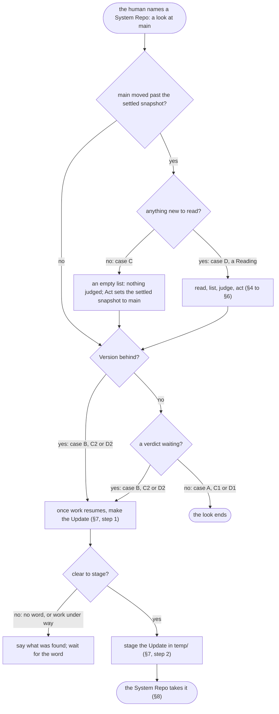

# A System Repo's Change, as a Flow

<!-- A draft of the knowledge work (ADR-0082). It pictures the System Repo's commits in the round of
     temp/common-ground/system-repo-change-simulation.md, and the part acting on
     each, and the Maintainer Repo's choices. The facts live in the
     simulation, never here. "Now" pictures the simulation as it is.
     Each "After" section pictures one open decision, one drawing per
     option, each named by its option. When the decision is made, the
     simulation changes, the chosen option's drawing becomes "Now",
     and that "After" section goes. It goes once what it holds has
     landed in the rewrite into the layers model, and git keeps every
     version. -->

It uses the simulation's short forms: Change, Record, Copy, Update, Update Note, Take, Version, Reading, Register (`temp/common-ground/system-repo-change-simulation.md`, its table at the top).

## 1. What the reader must get

Each drawing is checked against these.

1. **R1, the order:** every step of one round, from a Change to the next Plan Step opening.
2. **R2, the repo:** which repo each step happens in.
3. **R3, what crosses:** a Reading only reads the System Repo, and writes nothing there. An Update is written only into the System Repo's `temp/`.
4. **R4, where main moves:** each place main moves.
5. **R5, what a Reading compares:** the two snapshots each Reading compares.
6. **R6, what is open:** each part not decided is marked open, and nothing decides it.

## 2. Now

**Key,** for every commit picture below:

- **commits:** imaginary commits of the System Repo, oldest first, top to bottom.
- **main, branches:** a step's or a Take's branch is cut from main, to its right. At its gate's close, main moves to the branch's last commit by fast-forward: a commit named again on main is no new commit.
- **Maintainer Repo:** a bracket joins the two snapshots a Reading compares: its top is the older, the *settled snapshot* or, after a Take, the clean copy, and its bottom is the stop. The commits between are history, opened only to understand something deeper. A Reading writes nothing in the System Repo. A bracket closes when the verdicts are acted on, and its stop becomes the *settled snapshot*. The *settled snapshot* is not a Take. The Maintainer Repo's parts stand between the commits, since it makes none.
- **System Repo:** its parts, each pointing at the commit it acts on.
- **┊:** no commit.

### The System Repo's commits

#### Picture 1, the Take inside its window

```
 Maintainer Repo                                   main      branches                               System Repo
 ───────────────                                   ────      ────────                               ───────────
 read and acted on                            ┌  c0 ●  earlier work, with Changes
                                              │     │
 settled snapshot: the last Reading's stop ─▶ └  c1 ●  earlier work, the last stop
                                                    │
 Reading 1 compares the last Take's           ┌  c2 ●  the last Take: Version 1 comes in      ◀──── 9. the last Take: main was still c1; its branch is not drawn
 clean copy, on c2's branch, with             │     │                                         ◀──── main moved to c2 when the Take's gate closed, as at c14
 c6, its stop. The commits between            │     ├─ cut ──────┐                            ◀──── 10. step 1 opens on Version 1
 are history                                  │     │            │
                                              │     │         c3 ●  work, no Copy changed
                                              │     │            │
                                              │     │         c4 ●  a Copy changed            ◀──── 1. a Change, with its Record
                                              │     │            │
                                              │     │         c5 ●  another Copy changed      ◀──── 1. another Change, with its Record
                                              │     │            │
                                              └     │         c6 ●  the gate closes           ◀──── 2, 3. the gate decides each Change, and closes
                                                    │            │
 4 to 6. Read, List, Judge                 ┐ ─▶  c6 ● ◀──────────┘                            ◀──── main moves to c6 by fast-forward, no new commit
 7. Act: c6 becomes the settled snapshot   │        ┊
 8. Deliver: the Update waits in temp/     ┘        ┊
                                                    ┊
                                                    ┊
                                                    │
                                                    ├─ cut ──────┐                            ◀──── 9. Take, once it checks: main is still the settled snapshot, c6,
                                                    │            │                                  and the Version is still 1, the one the Update was built from
                                                    │         c7 ●  the Update, as it arrived ◀──── committed in temp/, not yet in force: a record
                                                    │            │                                  of what came, before the Take changes anything
                                                    │            │
                                                    │         c8 ●  the new Adapted Case      ◀──── for taking, at Version 2, put in first; it runs the rest of the Take
                                                    │            ┊                            ┄┄┄┄┄ the files checked against the Update Note; no commit
 The next Reading compares c9, the            ┌     │         c9 ●  every Copy at Version 2   ◀──── Copies taken whole; every Record cleared
 clean copy, checked against Version          │     │            │
 2, with main's latest snapshot               │     │        c10 ●  a Change put back         ◀──── one per Change, each with a fresh Record
                                              │     │            │
                                              │     │        c11 ●  a verdict acted on        ◀──── zero or more: unsound reversed or kept, a question answered
                                              │     │            │
                                              │     │        c12 ●  Version 2 recorded        ◀──── with the commit that holds it, c9
                                              │     │            │
                                              │     │        c13 ●  the Update removed        ◀──── the Update and the Update Note leave temp/
                                              │     │            │
                                              └     │        c14 ●  the gate closes           ◀──── the gate decides each Change put back, and closes
                                                    │            │
                                                c14 ● ◀──────────┘                            ◀──── main moves to c14 by fast-forward, at the gate's close
                                                    │
                                                    └─ cut ──────┐                            ◀──── 10. step 2 opens on Version 2
                                                                 │
                                                             c15 ●  work, on Version 2
```

**Key:** as at the top of §2, and:

- **numbers:** 1 a Change, 2 the gate decides, 3 the gate closes, 4 Read, 5 List, 6 Judge, 7 Act, 8 Deliver, 9 the Take, 10 the next Plan Step opens.
- **Versions:** the picture starts in the middle of the work. c0 and c1 were read and acted on, the *settled snapshot* is c1, and c2 is the last Take, which brought Version 1 by the same parts as picture 1's Take from c7 to c14. Its branch is not drawn. The Copies stay at Version 1 until a Take brings Version 2.

| Commit | Where | System Repo | Maintainer Repo |
|---|---|---|---|
| c0 | main | earlier work, with Changes | read and acted on |
| c1 | main | earlier work, the last stop | read and acted on; the *settled snapshot* |
| c2 | main | 9. the last Take: main was still c1, and Version 1 comes in. Its branch is not drawn; main moved to c2 when its gate closed | Reading 1's older snapshot is this Take's clean copy, on its branch |
| c3 | step 1's branch | work, no Copy changed | history between Reading 1's snapshots |
| c4 | step 1's branch | 1. a Change: a Copy changed, with its Record | history between Reading 1's snapshots |
| c5 | step 1's branch | 1. another Change: another Copy changed, with its Record | history between Reading 1's snapshots |
| c6 | step 1's branch, then main | 2, 3. the gate decides each Change, and closes; main moves to c6 by fast-forward | Reading 1's stop |
| no commit | | | 4 to 6. Read, List, Judge: the last Take's clean copy compared with c6. 7. Act: c6 becomes the *settled snapshot*. 8. Deliver: the Update waits in `temp/` |
| no commit | main | 9. the Take checks, case 1: main is still the *settled snapshot*, c6, and the Version is still 1, the one the Update was built from (`temp/common-ground/system-repo-change-simulation.md` §8, step 1, *Before the Take*). Its branch is cut from c6 | |
| c7 | the Take's branch | the Update, as it arrived, committed in `temp/`, not yet in force | |
| c8 | the Take's branch | the new Adapted Case for taking, at Version 2, put in first; then the files are checked against the Update Note, with no commit | |
| c9 | the Take's branch | every Copy taken whole, at Version 2; every Record cleared | the clean copy: the next Reading's older snapshot, checked first against Version 2 |
| c10 | the Take's branch | a Change put back, with a fresh Record; one commit per Change | history between the next Reading's snapshots |
| c11 | the Take's branch | a verdict acted on; zero or more | history between the next Reading's snapshots |
| c12 | the Take's branch | Version 2 recorded, with the commit that holds it, c9 | history between the next Reading's snapshots |
| c13 | the Take's branch | the Update and its Update Note removed from `temp/` | history between the next Reading's snapshots |
| c14 | the Take's branch, then main | the Take's gate decides each Change put back, and closes; main moves to c14 by fast-forward (`temp/common-ground/system-repo-change-simulation.md` §8, step 1, *At the Take, in order*) | main's latest snapshot, until step 2's work reaches main |
| c15 | step 2's branch | 10. step 2 opens on Version 2 | |

#### Picture 2, the window missed

Step 2 opened before the Take: the Update waited in `temp/`, and the human postponed the Take (`temp/common-ground/system-repo-change-simulation.md` §8, step 1, *A postponed Take*). When step 2 opens before the Update is made, nothing is refused: no Update is staged while work is under way without the human's word, and it is made when work resumes, at the next opening (§7, step 1; step 2, *Before staging*).

```
 Maintainer Repo                                   main      branches                               System Repo
 ───────────────                                   ────      ────────                               ───────────
 read and acted on                            ┌  c0 ●  earlier work, with Changes
                                              │     │
 settled snapshot: the last Reading's stop ─▶ └  c1 ●  earlier work, the last stop
                                                    │
 Reading 1 compares the last Take's           ┌  c2 ●  the last Take: Version 1 comes in      ◀──── 9. the last Take: main was still c1; its branch is not drawn
 clean copy, on c2's branch, with             │     │                                         ◀──── main moved to c2 when the Take's gate closed, as at c17
 c6, its stop. The commits between            │     ├─ cut ──────┐                            ◀──── 10. step 1 opens on Version 1
 are history                                  │     │            │
                                              │     │         c3 ●  work, no Copy changed
                                              │     │            │
                                              │     │         c4 ●  a Copy changed            ◀──── 1. a Change, with its Record
                                              │     │            │
                                              │     │         c5 ●  another Copy changed      ◀──── 1. another Change, with its Record
                                              │     │            │
                                              └     │         c6 ●  the gate closes           ◀──── 2, 3. the gate decides each Change, and closes
                                                    │            │
 4 to 8. Read, List, Judge, Act,           ┐  ┌  c6 ● ◀──────────┘                            ◀──── main moves to c6 by fast-forward, no new commit
 Deliver; c6 becomes the settled snapshot; │  │     ┊
 the Update waits in temp/                 ┘  │     ┊
                                              │     │
                                              │     └─ cut ──────┐                            ◀──── 9. the Take postponed, with its why
                                              │                  │                            ◀──── 10. step 2 opens on Version 1
 Reading 2 compares c6, the settled snapshot, │               c7 ●  work, on Version 1
 with c9, its stop. The commits               │                  │
 between are history                          │               c8 ●  a Copy changed            ◀──── 1. a Change, with its Record
                                              │                  │
                                              └               c9 ●  the gate closes           ◀──── 2, 3. the gate decides each Change, and closes
                                                                 │
                                                 c9 ● ◀──────────┘                            ◀──── main moves to c9 by fast-forward, no new commit
                                                    ┊                                         ┄┄┄┄┄ 9. Take, at step 3's opening: case 2, main is c9, not c6, so no Take; no commit
 4 to 8 again. Read, List, Judge, Act,     ┐        ┊
 Deliver; c9 becomes the settled snapshot; │        ┊
 a new Update replaces the waiting one     ┘        ┊
                                                    │
                                                    ├─ cut ──────┐                            ◀──── 9. Take, once it checks: main is still Reading 2's stop, c9,
                                                    │            │                                  and the Version is still 1, the one the Update was built from
                                                    │        c10 ●  the Update, as it arrived ◀──── committed in temp/, not yet in force: a record
                                                    │            │                                  of what came, before the Take changes anything
                                                    │            │
                                                    │        c11 ●  the new Adapted Case      ◀──── for taking, at Version 2, put in first; it runs the rest of the Take
                                                    │            ┊                            ┄┄┄┄┄ the files checked against the Update Note; no commit
 The next Reading compares c12, the           ┌     │        c12 ●  every Copy at Version 2   ◀──── Copies taken whole; every Record cleared
 clean copy, checked against Version          │     │            │
 2, with main's latest snapshot               │     │        c13 ●  a Change put back         ◀──── one per Change, each with a fresh Record
                                              │     │            │
                                              │     │        c14 ●  a verdict acted on        ◀──── zero or more: unsound reversed or kept, a question answered
                                              │     │            │
                                              │     │        c15 ●  Version 2 recorded        ◀──── with the commit that holds it, c12
                                              │     │            │
                                              │     │        c16 ●  the Update removed        ◀──── the Update and the Update Note leave temp/
                                              │     │            │
                                              └     │        c17 ●  the gate closes           ◀──── the gate decides each Change put back, and closes
                                                    │            │
                                                c17 ● ◀──────────┘                            ◀──── main moves to c17 by fast-forward, at the gate's close
                                                    │
                                                    └─ cut ──────┐                            ◀──── 10. step 3 opens on Version 2
                                                                 │
                                                             c18 ●  work, on Version 2
```

Key: as in picture 1.

| Commit | Where | System Repo | Maintainer Repo |
|---|---|---|---|
| c0 | main | earlier work, with Changes | read and acted on |
| c1 | main | earlier work, the last stop | read and acted on; the *settled snapshot* |
| c2 | main | 9. the last Take: main was still c1, and Version 1 comes in. Its branch is not drawn; main moved to c2 when its gate closed | Reading 1's older snapshot is this Take's clean copy, on its branch |
| c3 | step 1's branch | work, no Copy changed | history between Reading 1's snapshots |
| c4 | step 1's branch | 1. a Change: a Copy changed, with its Record | history between Reading 1's snapshots |
| c5 | step 1's branch | 1. another Change: another Copy changed, with its Record | history between Reading 1's snapshots |
| c6 | step 1's branch, then main | 2, 3. the gate decides each Change, and closes; main moves to c6 by fast-forward | Reading 1's stop; then the *settled snapshot*, Reading 2's older snapshot |
| no commit | | | 4 to 8. Read, List, Judge, Act, Deliver: the last Take's clean copy compared with c6; c6 becomes the *settled snapshot*; the Update waits in `temp/` |
| open | | 9. the Take postponed, with its why: where the why is written, and so whether it is a commit, is open | |
| c7 | step 2's branch | 10. step 2 opens: work on Version 1 | history between Reading 2's snapshots |
| c8 | step 2's branch | 1. a Change: a Copy changed, with its Record | history between Reading 2's snapshots |
| c9 | step 2's branch, then main | 2, 3. the gate decides each Change, and closes; main moves to c9 by fast-forward | Reading 2's stop |
| no commit | | 9. the Take checks at step 3's opening, case 2: main is c9, not c6, so there is no Take, and the System Repo says so (`temp/common-ground/system-repo-change-simulation.md` §8, step 1, *Before the Take*) | |
| no commit | | | 4 to 8 again. Read, List, Judge, Act, Deliver: c6 compared with c9; c9 becomes the *settled snapshot*; a new Update replaces the waiting one, and carries its verdicts not yet sent (`temp/common-ground/system-repo-change-simulation.md` §8, step 1, *Before the Take*) |
| no commit | main | 9. the Take checks, case 1: main is still Reading 2's stop, c9, and the Version is still 1, the one the Update was built from. Its branch is cut from c9 | |
| c10 | the Take's branch | the Update, as it arrived, committed in `temp/`, not yet in force | |
| c11 | the Take's branch | the new Adapted Case for taking, at Version 2, put in first; then the files are checked against the Update Note, with no commit | |
| c12 | the Take's branch | every Copy taken whole, at Version 2; every Record cleared | the clean copy: the next Reading's older snapshot, checked first against Version 2 |
| c13 | the Take's branch | a Change put back, with a fresh Record; one commit per Change | history between the next Reading's snapshots |
| c14 | the Take's branch | a verdict acted on; zero or more | history between the next Reading's snapshots |
| c15 | the Take's branch | Version 2 recorded, with the commit that holds it, c12 | history between the next Reading's snapshots |
| c16 | the Take's branch | the Update and its Update Note removed from `temp/` | history between the next Reading's snapshots |
| c17 | the Take's branch, then main | the Take's gate decides each Change put back, and closes; main moves to c17 by fast-forward | main's latest snapshot, until step 3's work reaches main |
| c18 | step 3's branch | 10. step 3 opens on Version 2 | |

### A look, to the Update staged

What the Maintainer Repo does with one System Repo, from a look at main to the Update staged, drawn as its choices. Each step names its section of `temp/common-ground/system-repo-change-simulation.md`.



### The Take

The System Repo takes an Update at a Plan Step's opening, on a branch of its own (`temp/common-ground/system-repo-change-simulation.md` §8, step 1). It is drawn once, here; each case that ends in an Update points at it. "Item" names an item of §8's *At the Take, in order*.

```
 Maintainer Repo                                   main      branches                               System Repo
 ───────────────                                   ────      ────────                               ───────────
 ── before ─────────────────────────────────────────┼───────────────────────────────────────────────────────────
                         settled snapshot ─▶     c1 ●  the last gate closed                   ◀──── the Copies at Version 1; the System Kit has since reached Version 2
 Deliver (§7):                                      ┊
   makes the Update: every Copy at Version 2,       ┊
   and an Update Note for Copies at Version 1       ┊
   stages it in the System Repo's temp/             ┊
                                                    │
 ── the check ──────────────────────────────────────┼───────────────────────────────────────────────────────────
                                                    ┊                                         ┄┄┄┄┄ at a Plan Step's opening, the Take checks first, from the Update Note:
                                                    ┊                                               case 1, main is still c1, the settled snapshot, and the Version is still 1:
                                                    ┊                                               the Update is taken, below. Case 2, anything else: no Take; the System Repo
                                                    ┊                                               says so, and the human has it looked at. The Take may also be postponed,
                                                    ┊                                               with its why, and starts again from this check at the next opening
                                                    │
 ── the Take ───────────────────────────────────────┼───────────────────────────────────────────────────────────
                                                    ├─ cut ──────┐                            ◀──── the Take's branch, cut from c1
                                                    │            │
                                                    │         c2 ●  the Update, as it arrived ◀──── committed in temp/, not yet in force: a record of what came
                                                    │            │
                                                    │         c3 ●  the new Adapted Case      ◀──── item 1: for taking, at Version 2, put in first; it runs the rest
                                                    │            ┊                            ┄┄┄┄┄ item 2: the files checked against the Update Note; no commit
 c4, the clean copy: the next Reading               │         c4 ●  every Copy at Version 2   ◀──── item 3: Copies taken whole; every Record cleared
 starts here, checked against Version 2             │            │
                                                    │         c5 ●  a Change put back         ◀──── item 4: one per Change still needed, with a fresh Record; zero or more
                                                    │            │
                                                    │         c6 ●  a verdict acted on        ◀──── item 5: unsound reversed or kept, a question answered; zero or more
                                                    │            │
                                                    │         c7 ●  Version 2 recorded        ◀──── item 6: with the commit that holds it, c4
                                                    │            │
                                                    │         c8 ●  the Update removed        ◀──── item 7: the Update and the Update Note leave temp/
                                                    │            │
                                                    │         c9 ●  the gate closes           ◀──── item 8: the gate decides each Change put back and verdict acted on
                                                    │            │
                                                 c9 ● ◀──────────┘                            ◀──── main moves to c9 by fast-forward, at the gate's close
                                                    │
 ── after ──────────────────────────────────────────┼───────────────────────────────────────────────────────────
                                                    └─ cut ──────┐                            ◀──── the next Plan Step opens on Version 2
                                                                 │
                                                             c10 ●  work, on Version 2
```

### A look's cases

A look at main makes three checks and ends in one of six cases: A, B, C1, C2, D1 and D2 (`temp/common-ground/system-repo-change-simulation.md` §4, step 1, *A look at main*). Each case is drawn on its own. Three lines split each picture into before, now and after. Now holds the Maintainer Repo's parts, in the simulation's order: Read, with the look and its case, Judge, Act on the verdicts and Deliver. The System Repo's parts, a Change and the Take, stand in before and after. The examples are pure: every Change is taken into the System Kit, and no Attention Note is written; the rest waits (`TODO.md`, the item on a project's own Changes and Attention Notes). Above each picture, a table gives that example's answers to the look's checks; check 2 is asked only when main moved, so A and B show "—". What defines each case is the simulation's table.

#### Case A, nothing follows

| Main moved | Copy changed | Version behind | Verdict waiting | What follows |
|---|---|---|---|---|
| no | — | no | no | nothing |

```
 Maintainer Repo                                   main      branches                               System Repo
 ───────────────                                   ────      ────────                               ───────────
 ── before ─────────────────────────────────────────┼───────────────────────────────────────────────────────────
 read and acted on                            ┌  c0 ●  earlier steps and Takes                ◀──── history
                                              │     │
 settled snapshot: the last Reading's stop ─▶ └  c1 ●  the last gate closed                   ◀──── the Copies at Version 1, the newest
                                                    │
 ── now ────────────────────────────────────────────┼───────────────────────────────────────────────────────────
 before the System Repo's next Plan Step, the       ┊
 human has the Maintainer Repo look at it           ┊
 (§8, Before the Take):                             ┊
 Read (§4):                                         ┊
   the look at main (§4, step 1):                   ┊
   check 1: main is c1, the settled snapshot.       ┊
   Main has not moved                               ┊
   check 3: the Version is the newest, and          ┊
   no verdict waits                                 ┊
   case A. What follows: nothing                    ┊
   gives: the stop, c1, and an empty list           ┊
 Judge (§5): gives no verdicts                      ┊
 Act on the verdicts (§6): nothing to act on;       ┊
   the settled snapshot set to the stop, c1,        ┊
   as it was                                        ┊
 Deliver (§7): none, nothing to send                ┊
                                                    │
 ── after ──────────────────────────────────────────┼───────────────────────────────────────────────────────────
                                                    └─ cut ──────┐                            ◀──── step 2 opens on Version 1
                                                                 │
                                                             c2 ●  work, on Version 1         ◀──── it reaches main at its gate; the next look sees it
```

#### Case B, an Update follows

| Main moved | Copy changed | Version behind | Verdict waiting | What follows |
|---|---|---|---|---|
| no | — | yes | no | an Update |

```
 Maintainer Repo                                   main      branches                               System Repo
 ───────────────                                   ────      ────────                               ───────────
 ── before ─────────────────────────────────────────┼───────────────────────────────────────────────────────────
 read and acted on                            ┌  c0 ●  earlier steps and Takes                ◀──── history
                                              │     │
 settled snapshot: the last Reading's stop ─▶ └  c1 ●  the last gate closed                   ◀──── the Copies at Version 1; the System Kit has since reached Version 2
                                                    │
 ── now ────────────────────────────────────────────┼───────────────────────────────────────────────────────────
 before the System Repo's next Plan Step, the       ┊
 human has the Maintainer Repo look at it           ┊
 (§8, Before the Take):                             ┊
 Read (§4):                                         ┊
   the look at main (§4, step 1):                   ┊
   check 1: main is c1, the settled snapshot.       ┊
   Main has not moved                               ┊
   check 3: the Version is 1, and the newest        ┊
   is 2                                             ┊
   case B. What follows: an Update is made          ┊
   and delivered                                    ┊
   gives: the stop, c1, and an empty list           ┊
 Judge (§5): gives no verdicts                      ┊
 Act on the verdicts (§6): nothing to act on;       ┊
   the settled snapshot set to the stop, c1,        ┊
   as it was                                        ┊
 Deliver (§7):                                      ┊
   makes the Update: every Copy at Version 2,       ┊
   and an Update Note for Copies at Version 1       ┊
   stages it in the System Repo's temp/             ┊
                                                    │
 ── after ──────────────────────────────────────────┼───────────────────────────────────────────────────────────
                                                    ├─ cut ──────┐                            ◀──── the Take (§8), once it checks: main is still c1, the settled snapshot,
                                                    │            │                                  and the Version is still 1, the one the Update was built from
                                                    │         c2 ●  the Update, as it arrived ◀──── the Take's commits, as drawn in The Take, above
                                                    │            │                            ◀──── c3 to c8, not drawn
                                                    │         c9 ●  the gate closes           ◀──── the Take's gate decides each Change put back, and closes
                                                    │            │
                                                 c9 ● ◀──────────┘                            ◀──── main moves to c9 by fast-forward, at the gate's close
                                                    │
                                                    └─ cut ──────┐                            ◀──── step 2 opens on Version 2
                                                                 │
                                                             c10 ●  work, on Version 2
```

#### Case C1, nothing to read

| Main moved | Copy changed | Version behind | Verdict waiting | What follows |
|---|---|---|---|---|
| yes | no | no | no | the settled snapshot moves up to main; nothing else |

```
 Maintainer Repo                                   main      branches                               System Repo
 ───────────────                                   ────      ────────                               ───────────
 ── before ─────────────────────────────────────────┼───────────────────────────────────────────────────────────
 read and acted on                            ┌  c0 ●  earlier steps and Takes                ◀──── history
                                              │     │
 settled snapshot: the last Reading's stop ─▶ └  c1 ●  the last gate closed                   ◀──── the Copies at Version 1, the newest
                                                    │
                                                    ├─ cut ──────┐                            ◀──── step 1 opens on Version 1
                                                    │            │
                                                    │         c2 ●  work, no Copy changed
                                                    │            │
                                                    │         c3 ●  the gate closes           ◀──── the gate (§3, step 2): no Change to decide; it closes
                                                    │            │
                                                 c3 ● ◀──────────┘                            ◀──── main moves to c3 by fast-forward, no new commit
                                                    │
 ── now ────────────────────────────────────────────┼───────────────────────────────────────────────────────────
 before the System Repo's next Plan Step, the       ┊
 human has the Maintainer Repo look at it           ┊
 (§8, Before the Take):                             ┊
 Read (§4):                                         ┊
   the look at main (§4, step 1):                   ┊
   check 1: main is c3, past the settled            ┊
   snapshot, c1. Main has moved                     ┊
   check 2: c1 against c3: no Copy changed          ┊
   check 3: the Version is the newest, and          ┊
   no verdict waits                                 ┊
   case C1. What follows: nothing else              ┊
   gives: the stop, c3, and an empty list           ┊
 Judge (§5): gives no verdicts                      ┊
 Act on the verdicts (§6): nothing to act on;       ┊
   the settled snapshot set to the stop, c3         ┊
 Deliver (§7): none, nothing to send                ┊
                                                    │
 ── after ──────────────────────────────────────────┼───────────────────────────────────────────────────────────
                                                    └─ cut ──────┐                            ◀──── step 2 opens on Version 1
                                                                 │
                                                              c4 ●  work, on Version 1        ◀──── the next look compares c3, the settled snapshot, with main
```

#### Case C2, an Update follows

| Main moved | Copy changed | Version behind | Verdict waiting | What follows |
|---|---|---|---|---|
| yes | no | yes | no | the settled snapshot moves up to main; an Update |

```
 Maintainer Repo                                   main      branches                               System Repo
 ───────────────                                   ────      ────────                               ───────────
 ── before ─────────────────────────────────────────┼───────────────────────────────────────────────────────────
 read and acted on                            ┌  c0 ●  earlier steps and Takes                ◀──── history
                                              │     │
 settled snapshot: the last Reading's stop ─▶ └  c1 ●  the last gate closed                   ◀──── the Copies at Version 1; the System Kit has since reached Version 2
                                                    │
                                                    ├─ cut ──────┐                            ◀──── step 1 opens on Version 1
                                                    │            │
                                                    │         c2 ●  work, no Copy changed
                                                    │            │
                                                    │         c3 ●  the gate closes           ◀──── the gate (§3, step 2): no Change to decide; it closes
                                                    │            │
                                                 c3 ● ◀──────────┘                            ◀──── main moves to c3 by fast-forward, no new commit
                                                    │
 ── now ────────────────────────────────────────────┼───────────────────────────────────────────────────────────
 before the System Repo's next Plan Step, the       ┊
 human has the Maintainer Repo look at it           ┊
 (§8, Before the Take):                             ┊
 Read (§4):                                         ┊
   the look at main (§4, step 1):                   ┊
   check 1: main is c3, past the settled            ┊
   snapshot, c1. Main has moved                     ┊
   check 2: c1 against c3: no Copy changed          ┊
   check 3: the Version is 1, and the newest        ┊
   is 2                                             ┊
   case C2. What follows: an Update is made         ┊
   and delivered                                    ┊
   gives: the stop, c3, and an empty list           ┊
 Judge (§5): gives no verdicts                      ┊
 Act on the verdicts (§6): nothing to act on;       ┊
   the settled snapshot set to the stop, c3         ┊
 Deliver (§7):                                      ┊
   makes the Update: every Copy at Version 2,       ┊
   and an Update Note for Copies at Version 1       ┊
   stages it in the System Repo's temp/             ┊
                                                    │
 ── after ──────────────────────────────────────────┼───────────────────────────────────────────────────────────
                                                    ├─ cut ──────┐                            ◀──── the Take (§8), once it checks: main is still c3, the settled snapshot,
                                                    │            │                                  and the Version is still 1, the one the Update was built from
                                                    │         c4 ●  the Update, as it arrived ◀──── the Take's commits, as drawn in The Take, above
                                                    │            │                            ◀──── c5 to c10, not drawn
                                                    │        c11 ●  the gate closes           ◀──── the Take's gate decides each Change put back, and closes
                                                    │            │
                                                c11 ● ◀──────────┘                            ◀──── main moves to c11 by fast-forward, at the gate's close
                                                    │
                                                    └─ cut ──────┐                            ◀──── step 2 opens on Version 2
                                                                 │
                                                             c12 ●  work, on Version 2
```

#### Case D2, an Update follows

| Main moved | Copy changed | Version behind | Verdict waiting | What follows |
|---|---|---|---|---|
| yes | yes | yes, after acting | no | the Reading; an Update |

The example's Update brings back the System Repo's own lesson: depth b, the System Kit's Adapted Case changing (`temp/common-ground/system-repo-change-simulation.md` §2, the "how deep" rows). The Take is drawn in full, to show what it does with a Change Version 2 already holds.

```
 Maintainer Repo                                   main      branches                               System Repo
 ───────────────                                   ────      ────────                               ───────────
 ── before ─────────────────────────────────────────┼───────────────────────────────────────────────────────────
 read and acted on                            ┌  c0 ●  earlier steps and Takes                ◀──── history
                                              │     │
 settled snapshot: the last Reading's stop ─▶ └  c1 ●  the last gate closed                   ◀──── the Copies at Version 1, the newest
                                                    │
                                                    ├─ cut ──────┐                            ◀──── step 1 opens on Version 1
                                                    │            │
                                                    │         c2 ●  a Copy changed            ◀──── a Change, with its Record; its proposal: any repo would meet it
                                                    │            │
                                                    │         c3 ●  the gate closes           ◀──── the gate (§3, step 2): the Change kept; it closes
                                                    │            │
                                                 c3 ● ◀──────────┘                            ◀──── main moves to c3 by fast-forward, no new commit
                                                    │
 ── now ────────────────────────────────────────────┼───────────────────────────────────────────────────────────
 before the System Repo's next Plan Step, the       ┊
 human has the Maintainer Repo look at it           ┊
 (§8, Before the Take):                             ┊
 Read (§4):                                         ┊
   the look at main (§4, step 1):                   ┊
   check 1: main is c3, past the settled            ┊
   snapshot, c1. Main has moved                     ┊
   check 2: c1 against c3: a Copy changed           ┊
   case D. What follows: the Reading                ┊
   the Reading: c1 compared with c3; one            ┊
   line, the Change with its Record                 ┊
   gives: the stop, c3, and a list of one line      ┊
 Judge (§5): one verdict: a lesson for its          ┊
   Adapted Case, depth b; the proposal holds        ┊
 Act on the verdicts (§6): the System Kit's         ┊
   Adapted Case gains the lesson, reworded:         ┊
   the System Kit reaches Version 2. The            ┊
   settled snapshot set to the stop, c3             ┊
 Deliver (§7):                                      ┊
   check 3, after acting: the Version is 1,         ┊
   and the newest is 2: case D2. What follows:      ┊
   an Update is made and delivered                  ┊
   makes the Update: every Copy at Version 2,       ┊
   and an Update Note for Copies at Version 1,      ┊
   giving the lesson as the why                     ┊
   stages it in the System Repo's temp/             ┊
                                                    │
 ── after ──────────────────────────────────────────┼───────────────────────────────────────────────────────────
                                                    ├─ cut ──────┐                            ◀──── the Take (§8), once it checks: main is still c3, the settled snapshot,
                                                    │            │                                  and the Version is still 1
                                                    │         c4 ●  the Update, as it arrived ◀──── committed in temp/, not yet in force
                                                    │            │
                                                    │         c5 ●  the new Adapted Case      ◀──── item 1: for taking, at Version 2, put in first
                                                    │            ┊                            ┄┄┄┄┄ item 2: the files checked against the Update Note; no commit
 c6, the clean copy: the next Reading               │         c6 ●  every Copy at Version 2   ◀──── item 3: Copies taken whole; every Record cleared, c2's among them
 starts here, checked against Version 2             │            ┊                            ┄┄┄┄┄ item 4: nothing put back: Version 2 holds the lesson; no commit
                                                    │            ┊                            ┄┄┄┄┄ item 5: no verdict came; the proposal held; no commit
                                                    │         c7 ●  Version 2 recorded        ◀──── item 6: with the commit that holds it, c6
                                                    │            │
                                                    │         c8 ●  the Update removed        ◀──── item 7: the Update and the Update Note leave temp/
                                                    │            │
                                                    │         c9 ●  the gate closes           ◀──── item 8: no Change put back to decide; it closes
                                                    │            │
                                                 c9 ● ◀──────────┘                            ◀──── main moves to c9 by fast-forward, at the gate's close
                                                    │
                                                    └─ cut ──────┐                            ◀──── step 2 opens on Version 2
                                                                 │
                                                             c10 ●  work, on Version 2        ◀──── the next look compares c6, the clean copy, with main
```
