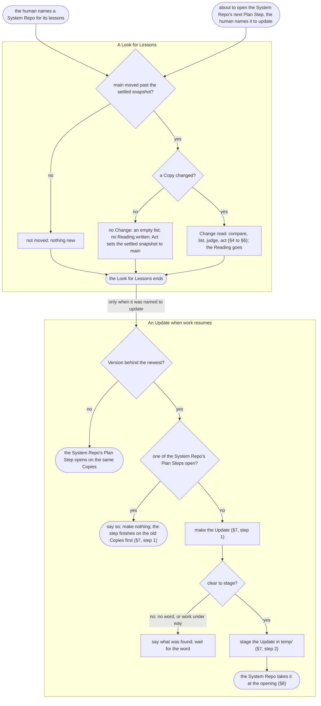

# A System Repo's Change, as a Flow

<!-- A draft of the knowledge work (ADR-0082). It pictures the System Repo's commits in the round of
     temp/common-ground/system-repo-change-simulation.md, and the part acting on
     each, and the Maintainer Repo's choices. The facts live in the
     simulation, never here. "Now" pictures the simulation as it is.
     Each "After" section pictures one open decision, one drawing per
     option, each named by its option. When the decision is made, the
     simulation changes, the chosen option's drawing becomes "Now",
     and that "After" section goes. It goes once what it holds has
     landed in the rewrite into the layers model, and git keeps every
     version. -->

It uses the simulation's short forms: Change, Record, Copy, Update, Update Note, Take, Version, Reading, Register (`temp/common-ground/system-repo-change-simulation.md`, its table at the top).

## 1. What the reader must get

Each drawing is checked against these.

1. **R1, the order:** every step of one round, from a Change to the System Repo's next Plan Step opening.
2. **R2, the repo:** which repo each step happens in.
3. **R3, what crosses:** a Look for Lessons only reads the System Repo, and writes nothing there. An Update is written only into the System Repo's `temp/`.
4. **R4, where main moves:** each place main moves.
5. **R5, what a Look for Lessons compares:** the two snapshots each one compares.
6. **R6, what is open:** each part not decided is marked open, and nothing decides it.

## 2. Now

**Key,** for every commit picture below:

- **commits:** imaginary commits of the System Repo, oldest first, top to bottom.
- **main, branches:** a step's or a Take's branch is cut from main, to its right. At its gate's close, main moves to the branch's last commit by fast-forward: a commit named again on main is no new commit.
- **Maintainer Repo:** a bracket joins the two snapshots a Look for Lessons compares: its top is the older, the *settled snapshot* or, after a Take, the *version snapshot*, and its bottom is the stop. The commits between are history, opened only to understand something deeper. A Look for Lessons writes nothing in the System Repo. A bracket closes when the verdicts are acted on, and its stop becomes the *settled snapshot*. The *settled snapshot* is not a Take. The Maintainer Repo's parts stand between the commits, since it makes none.
- **System Repo:** its parts, each pointing at the commit it acts on.
- **┊:** no commit.

### The two jobs

What the Maintainer Repo does with one System Repo, drawn as its choices, in two jobs, each in its own box. A Look for Lessons runs when the human names a System Repo for its lessons, and ends once Act is done (`temp/common-ground/system-repo-change-simulation.md` §1, *How it is worked*). An Update when work resumes runs when the human, about to open the System Repo's next Plan Step, names it to update: the Look for Lessons runs first, then Deliver's check (`temp/common-ground/system-repo-change-simulation.md` §7, step 1, *When one is due*). A Look for Lessons ends in one of three cases: *not moved*, *no Change* and *Change read* (`temp/common-ground/system-repo-change-simulation.md` §4, step 1, *Two checks at main*). Each step names its section of the simulation.



### The Take

The System Repo takes an Update at the opening of the System Repo's next Plan Step, on a branch of its own (`temp/common-ground/system-repo-change-simulation.md` §8, step 1). It is drawn once, here, where the update job ends (*The two jobs*, above). "Item" names an item of §8's *At the Take, in order*.

```
 Maintainer Repo                                   main      branches                               System Repo
 ───────────────                                   ────      ────────                               ───────────
 ── before ─────────────────────────────────────────┼───────────────────────────────────────────────────────────
                         settled snapshot ─▶     c1 ●  the last gate closed                   ◀──── the Copies at Version 1; the System Kit has since reached Version 2
                                                    ┊                                         ┄┄┄┄┄ an Update waits in temp/, staged by Deliver (§7), not yet in force: every Copy
                                                    ┊                                               at Version 2, and an Update Note naming c1, the settled snapshot it was built against
                                                    │
 ── the check ──────────────────────────────────────┼───────────────────────────────────────────────────────────
                                                    ┊                                         ┄┄┄┄┄ at the opening of the System Repo's next Plan Step, the Take checks first, from the Update Note:
                                                    ┊                                               case 1, main is still c1, the settled snapshot: the Update is taken, below
                                                    ┊                                               case 2, anything else: no Take; the System Repo says so, and the human names it to update again
                                                    │
 ── the Take ───────────────────────────────────────┼───────────────────────────────────────────────────────────
                                                    ├─ cut ──────┐                            ◀──── the Take's branch, cut from c1
                                                    │            │
                                                    │         c2 ●  the Update, as it arrived ◀──── committed in temp/, not yet in force: a record of what came
                                                    │            │
                                                    │         c3 ●  the new Adapted Case      ◀──── item 1: for taking, at Version 2, put in first; it runs the rest
                                                    │            ┊                            ┄┄┄┄┄ item 2: the files checked against the Update Note; no commit
 c4, the version snapshot: the next                 │         c4 ●  every Copy at Version 2   ◀──── item 3: Copies taken whole, each path gone removed, each renamed moved; every Record cleared
 Look for Lessons compares from here                │            │
                                                    │         c5 ●  Version 2 recorded        ◀──── item 4: with the commit that holds it, c4; open: where in the System Repo Version 2 and c4 are written (§8, Open)
                                                    │            │
                                                    │         c6 ●  the Update removed        ◀──── item 5: the Update and the Update Note leave temp/
                                                    │            │
                                                    │         c7 ●  the gate closes           ◀──── item 6: the gate checks that the Take finished
                                                    │            │
                                                 c7 ● ◀──────────┘                            ◀──── main moves to c7 by fast-forward, at the gate's close
                                                    │
 ── after ──────────────────────────────────────────┼───────────────────────────────────────────────────────────
                                                    └─ cut ──────┐                            ◀──── the System Repo's next Plan Step opens on Version 2
                                                                 │
                                                              c8 ●  work, on Version 2
```

### The Look for Lessons' cases

A Look for Lessons ends in one of three cases: *not moved*, *no Change* and *Change read* (`temp/common-ground/system-repo-change-simulation.md` §4, step 1, *Two checks at main*). Each case is drawn on its own. Three lines split each picture into before, now and after. Before holds the System Repo's commits since the *settled snapshot*. Now holds the Maintainer Repo's parts, in the simulation's order: Read Changes, with the two checks, Judge, and Act on the verdicts. After holds the new *settled snapshot*; what may follow is listed once, below the pictures. Deliver and the Take are outside the Look for Lessons: *The two jobs* draws when they follow, and *The Take* draws the Take. The examples are pure, as the simulation is: every Change is taken into the System Kit (`temp/common-ground/system-repo-change-simulation.md` §2, *Known, not ruled*). Above each picture, a table gives that example's answers to the two checks; check 2 is asked only when main moved, so *not moved* shows "—". What defines each case is the simulation's table.

#### Case *not moved*

| Main moved | Copy changed |
|---|---|
| no | — |

```
 Maintainer Repo                                   main      branches                               System Repo
 ───────────────                                   ────      ────────                               ───────────
 ── before ─────────────────────────────────────────┼───────────────────────────────────────────────────────────
 taken into account by                        ┌  c0 ●  earlier Plan Steps and Takes           ◀──── history
 earlier Looks for Lessons                    │     │
 settled snapshot: the last stop           ─▶ └  c1 ●  the last gate closed                   ◀──── no Plan Step has closed since
                                                    │
 ── now ────────────────────────────────────────────┼───────────────────────────────────────────────────────────
 the human names the System Repo, for its           ┊
 lessons or to update it (§1)                       ┊
 Read Changes (§4): the stop is main, c1            ┊
   check 1: main is c1, the settled snapshot:       ┊
   not moved, nothing new                           ┊
 Judge (§5): nothing to judge                       ┊
 Act on the verdicts (§6): the settled              ┊
   snapshot set to the stop, c1, as it was          ┊
                                                    │
 ── after ──────────────────────────────────────────┼───────────────────────────────────────────────────────────
 settled snapshot: c1                       ─▶   c1 ●
 what may follow: the list below the pictures
```

#### Case *no Change*

| Main moved | Copy changed |
|---|---|
| yes | no |

```
 Maintainer Repo                                   main      branches                               System Repo
 ───────────────                                   ────      ────────                               ───────────
 ── before ─────────────────────────────────────────┼───────────────────────────────────────────────────────────
 taken into account by                        ┌  c0 ●  earlier Plan Steps and Takes           ◀──── history
 earlier Looks for Lessons                    │     │
 settled snapshot: the last stop           ─▶ └  c1 ●  the last gate closed
                                                    │
                                                    ├─ cut ──────┐                            ◀──── one of the System Repo's Plan Steps opens
                                                    │            │
                                                    │         c2 ●  work, no Copy changed
                                                    │            │
                                                    │         c3 ●  the gate closes           ◀──── the gate (§3, step 2): no Change to decide
                                                    │            │
                                                 c3 ● ◀──────────┘                            ◀──── main moves to c3 by fast-forward
                                                    │
 ── now ────────────────────────────────────────────┼───────────────────────────────────────────────────────────
 the human names the System Repo, for its           ┊
 lessons or to update it (§1)                       ┊
 Read Changes (§4): the stop is main, c3            ┊
   check 1: main is c3, past c1: moved              ┊
   check 2: c1 against c3: no Copy changed:         ┊
   no Change; no Reading written                    ┊
 Judge (§5): nothing to judge                       ┊
 Act on the verdicts (§6): the settled              ┊
   snapshot set to the stop, c3                     ┊
                                                    │
 ── after ──────────────────────────────────────────┼───────────────────────────────────────────────────────────
 settled snapshot: c3                       ─▶   c3 ●
 what may follow: the list below the pictures
```

#### Case *Change read*

| Main moved | Copy changed |
|---|---|
| yes | yes |

```
 Maintainer Repo                                   main      branches                               System Repo
 ───────────────                                   ────      ────────                               ───────────
 ── before ─────────────────────────────────────────┼───────────────────────────────────────────────────────────
 taken into account by                        ┌  c0 ●  earlier Plan Steps and Takes           ◀──── history
 earlier Looks for Lessons                    │     │
 settled snapshot: the last stop           ─▶ └  c1 ●  the last gate closed                   ◀──── the Copies at Version 1, the newest
                                                    │
                                                    ├─ cut ──────┐                            ◀──── one of the System Repo's Plan Steps opens
                                                    │            │
                                                    │         c2 ●  a Copy changed            ◀──── a Change, with its Record; its proposal: any repo would meet it
                                                    │            │
                                                    │         c3 ●  the gate closes           ◀──── the gate (§3, step 2): the Change kept
                                                    │            │
                                                 c3 ● ◀──────────┘                            ◀──── main moves to c3 by fast-forward
                                                    │
 ── now ────────────────────────────────────────────┼───────────────────────────────────────────────────────────
 the human names the System Repo, for its           ┊
 lessons or to update it (§1)                       ┊
 Read Changes (§4): the stop is main, c3            ┊
   check 1: main is c3, past c1: moved              ┊
   check 2: c1 against c3: a Copy changed:          ┊
   Change read. The Reading: one line, the          ┊
   Change with its Record                           ┊
 Judge (§5): one verdict: a lesson for its          ┊
   Adapted Case, depth b; the proposal holds        ┊
 Act on the verdicts (§6): the System Kit's         ┊
   Adapted Case gains the lesson, reworded:         ┊
   the System Kit reaches Version 2. The            ┊
   Reading goes. The settled snapshot set to        ┊
   the stop, c3                                     ┊
                                                    │
 ── after ──────────────────────────────────────────┼───────────────────────────────────────────────────────────
 settled snapshot: c3                       ─▶   c3 ●
 what may follow: the list below the pictures
```

**What may follow.** After every case, the same:

- if the human asked for the System Repo's lessons: nothing follows;
- if the human asked to update the System Repo: Deliver's check comes next, then the System Repo's next Plan Step opens, with or without an Update (`temp/common-ground/system-repo-change-simulation.md` §7, step 1);
- the System Repo: a Plan Step already open goes on, and the System Repo's next Plan Step opens once the human names the System Repo to update.

### The update job's outcomes

An Update when work resumes, the second job, runs when the human names the System Repo to update, and starts with a Look for Lessons (`temp/common-ground/system-repo-change-simulation.md` §7, step 1, *When one is due*). It ends in one of four outcomes: *not behind*, *step open*, *taken* and *refused*. Before staging, it may pause for the human's word or a clean tree (`temp/common-ground/system-repo-change-simulation.md` §7, step 2, *Before staging*); *taken* draws the pause. Each outcome is drawn on its own, split into before, now and after; *refused* adds a band for main moving before the Take, and one for the Take's check. The example: Version 1 in the System Repo, Version 2 the newest; the Look for Lessons ends in case *not moved*, drawn above. The Take is drawn once, in *The Take*, and *taken* points at it.

#### *not behind*

```
 Maintainer Repo                                   main      branches                               System Repo
 ───────────────                                   ────      ────────                               ───────────
 ── before ─────────────────────────────────────────┼───────────────────────────────────────────────────────────
 taken into account by                        ┌  c0 ●  earlier Plan Steps and Takes           ◀──── history
 earlier Looks for Lessons                    │     │
 settled snapshot                          ─▶ └  c1 ●  the last gate closed                   ◀──── the Copies at Version 1, the newest
                                                    │
 ── now ────────────────────────────────────────────┼───────────────────────────────────────────────────────────
 - the human, about to open the System Repo's       ┊
   next Plan Step, names it to update (§7, step 1)  ┊
 - Look for Lessons (§4 to §6): case not moved,     ┊
   drawn above; the settled snapshot stays c1       ┊
 - Deliver (§7): the System Repo's Version, 1,      ┊
   is the newest: no Update is due; nothing is      ┊
   made                                             ┊
                                                    │
 ── after ──────────────────────────────────────────┼───────────────────────────────────────────────────────────
                                                    └─ cut ──────┐                            ◀──── the System Repo's next Plan Step opens on Version 1
                                                                 │
                                                              c2 ●  work, on Version 1
```

#### *step open*

```
 Maintainer Repo                                   main      branches                               System Repo
 ───────────────                                   ────      ────────                               ───────────
 ── before ─────────────────────────────────────────┼───────────────────────────────────────────────────────────
 taken into account by                        ┌  c0 ●  earlier Plan Steps and Takes           ◀──── history
 earlier Looks for Lessons                    │     │
 settled snapshot                          ─▶ └  c1 ●  the last gate closed                   ◀──── the Copies at Version 1; the System Kit has since reached Version 2
                                                    │
                                                    ├─ cut ──────┐                            ◀──── one of the System Repo's Plan Steps opens
                                                    │            │
                                                    │         c2 ●  work, on Version 1        ◀──── the step is still open: no gate yet
                                                    │            ┊
 ── now ────────────────────────────────────────────┼───────────────────────────────────────────────────────────
 - the human names the System Repo to update,       ┊            ┊
   while one of its Plan Steps is still open        ┊            ┊
   (§7, step 1)                                     ┊            ┊
 - Look for Lessons (§4 to §6): case not moved;     ┊            ┊
   the open step's work waits for the next one      ┊            ┊
 - Deliver (§7): the Version is 1, the newest is    ┊            ┊
   2: behind                                        ┊            ┊
 - a Plan Step is open: the agent says so, and      ┊            ┊
   makes nothing (§7, step 1)                       ┊            ┊
                                                    │            ┊
 ── after ──────────────────────────────────────────┼───────────────────────────────────────────────────────────
                                                    │            │
                                                    │         c3 ●  the gate closes           ◀──── the gate (§3, step 2)
                                                    │            │
                                                 c3 ● ◀──────────┘                            ◀──── main moves to c3 by fast-forward
 - the open step finishes on Version 1, and its     │
   gate moves main to c3 (§8, Before the Take)      │
 - at the next opening, the human names the         │
   System Repo to update again                      │
 - Look for Lessons: main moved; case no Change     │
   or Change read, by what c3 holds                 │
 - then as in taken                                 │
```

#### *taken*

```
 Maintainer Repo                                   main      branches                               System Repo
 ───────────────                                   ────      ────────                               ───────────
 ── before ─────────────────────────────────────────┼───────────────────────────────────────────────────────────
 taken into account by                        ┌  c0 ●  earlier Plan Steps and Takes           ◀──── history
 earlier Looks for Lessons                    │     │
 settled snapshot                          ─▶ └  c1 ●  the last gate closed                   ◀──── the Copies at Version 1; the System Kit has since reached Version 2
                                                    │
 ── now ────────────────────────────────────────────┼───────────────────────────────────────────────────────────
 - the human, about to open the System Repo's       ┊
   next Plan Step, names it to update (§7, step 1)  ┊
 - Look for Lessons (§4 to §6): here case not       ┊
   moved; the settled snapshot stays c1. Any of     ┊
   its three cases leads on the same way: see       ┊
   An Update at the newest Version, below           ┊
 - Deliver (§7): the Version is 1, the newest is    ┊
   2: behind; no Plan Step open (§7, step 1)        ┊
 - Deliver makes the Update: every Copy at          ┊
   Version 2, and an Update Note naming c1          ┊
 - before staging (§7, step 2): when the System     ┊
   Repo's tree is not clean, or no word yet, the    ┊
   agent says what it found, and waits              ┊
 - on the word, Deliver stages the Update in the    ┊
   System Repo's temp/                              ┊
                                                    ┊                                         ┄┄┄┄┄ the Update waits in temp/, not yet in force
                                                    │
 ── after ──────────────────────────────────────────┼───────────────────────────────────────────────────────────
                                                    ├─ cut ──────┐                            ◀──── the Take (§8), once it checks: main is still c1, the settled snapshot
                                                    │            │
                                                    │         c2 ●  the Update, as it arrived ◀──── the Take's commits, as drawn in The Take
                                                    │            │                            ◀──── c3 to c6, not drawn
                                                    │         c7 ●  the gate closes           ◀──── the Take's gate checks that the Take finished
                                                    │            │
                                                 c7 ● ◀──────────┘                            ◀──── main moves to c7 by fast-forward, at the gate's close
                                                    │
                                                    └─ cut ──────┐                            ◀──── the System Repo's next Plan Step opens on Version 2
                                                                 │
                                                              c8 ●  work, on Version 2
```

#### *refused*

```
 Maintainer Repo                                   main      branches                               System Repo
 ───────────────                                   ────      ────────                               ───────────
 ── before ─────────────────────────────────────────┼───────────────────────────────────────────────────────────
 taken into account by                        ┌  c0 ●  earlier Plan Steps and Takes           ◀──── history
 earlier Looks for Lessons                    │     │
 settled snapshot                          ─▶ └  c1 ●  the last gate closed                   ◀──── the Copies at Version 1; the System Kit has since reached Version 2
                                                    │
 ── now ────────────────────────────────────────────┼───────────────────────────────────────────────────────────
 - the human, about to open the System Repo's       ┊
   next Plan Step, names it to update (§7, step 1)  ┊
 - Look for Lessons (§4 to §6): case not moved,     ┊
   drawn above; the settled snapshot stays c1       ┊
 - Deliver (§7): the Version is 1, the newest is    ┊
   2: behind; no Plan Step open (§7, step 1)        ┊
 - Deliver makes the Update, its Update Note        ┊
   naming c1                                        ┊
 - Deliver stages it in the System Repo's temp/     ┊
                                                    ┊                                         ┄┄┄┄┄ the Update waits in temp/, not yet in force
                                                    │
 ── before the Take ────────────────────────────────┼───────────────────────────────────────────────────────────
                                                 c2 ●  a gate closed                          ◀──── main moved past c1 before the Take; how is open: postponing a Take (§8, Open)
                                                    │
 ── the check ──────────────────────────────────────┼───────────────────────────────────────────────────────────
                                                    ┊                                         ┄┄┄┄┄ at the opening, the Take checks, from the Update Note:
                                                    ┊                                               main is c2, not c1: case 2, no Take; the System Repo says so (§8)
                                                    │
 ── after ──────────────────────────────────────────┼───────────────────────────────────────────────────────────
 - the Update stays in temp/, not taken             │
 - the human names the System Repo to update        │
   again (§8, Before the Take)                      │
 - Look for Lessons: main moved; case no Change     │
   or Change read, by what c2 holds                 │
 - Deliver makes a new Update against c2 and the    │
   newest Version; it replaces the waiting one      │
   (§7, step 1)                                     │
```

**An Update at the newest Version.** An Update is always made at the newest Version. When the Look for Lessons ends in *Change read*, Act may raise the Version first: the Update is then made at that Version, and brings the System Repo's own lesson back. If the System Kit moves after it is made, the Update is still taken, and the next brings the rest (`temp/common-ground/system-repo-change-simulation.md` §8, step 1, *A check before delivery*).
