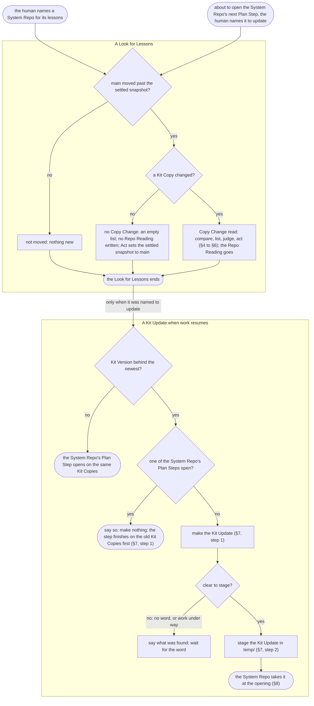

# A System Repo's Copy Change, as a Flow

<!-- A draft of the knowledge work (ADR-0082). It pictures the System Repo's commits in the round of
     temp/common-ground/system-repo-change-simulation.md, and the part acting on
     each, and the Maintainer Repo's choices. The facts live in the
     simulation, never here. "Now" pictures the simulation as it is.
     Each "After" section pictures one open decision, one drawing per
     option, each named by its option. When the decision is made, the
     simulation changes, the chosen option's drawing becomes "Now",
     and that "After" section goes. It goes once what it holds has
     landed in the rewrite into the layers model, and git keeps every
     version. -->

It uses the layers document's short forms: Copy Change, Change Record, Kit Copy, Kit Update, Update Note, Update Take, Kit Version, Repo Reading, Repo Register (`temp/common-ground/knowledge-layers.md` §2, *The layers*).

## 1. What the reader must get

Each drawing is checked against these.

1. **R1, the order:** every step of one round, from a Copy Change to the System Repo's next Plan Step opening.
2. **R2, the repo:** which repo each step happens in.
3. **R3, what crosses:** a Look for Lessons only reads the System Repo, and writes nothing there. A Kit Update is written only into the System Repo's `temp/`.
4. **R4, where main moves:** each place main moves.
5. **R5, what a Look for Lessons compares:** the two snapshots each one compares.
6. **R6, what is open:** each part not decided is marked open, and nothing decides it.

## 2. Now

**Key,** for every commit picture below:

- **commits:** imaginary commits of the System Repo, oldest first, top to bottom.
- **main, branches:** a step's or an Update Take's branch is cut from main, to its right. At its gate's close, main moves to the branch's last commit by fast-forward: a commit named again on main is no new commit.
- **Maintainer Repo:** a bracket joins the two snapshots a Look for Lessons compares: its top is the older, the *settled snapshot* or, after an Update Take, the *version snapshot*, and its bottom is the stop. The commits between are history, opened only to understand something deeper. A Look for Lessons writes nothing in the System Repo. A bracket closes when the verdicts are acted on, and its stop becomes the *settled snapshot*. The *settled snapshot* is not an Update Take. The Maintainer Repo's parts stand between the commits, since it makes none.
- **System Repo:** its parts, each pointing at the commit it acts on.
- **┊:** no commit.

### The two jobs

What the Maintainer Repo does with one System Repo, drawn as its choices, in two jobs, each in its own box. A Look for Lessons runs when the human names a System Repo for its lessons, and ends once Act is done (`temp/common-ground/knowledge-layers.md` §3.2, *How a change travels*). A Kit Update when work resumes runs when the human, about to open the System Repo's next Plan Step, names it to update: the Look for Lessons runs first, then the check in Deliver the Kit Update (`temp/common-ground/knowledge-layers.md` §3.2.5, *Deliver the Kit Update*). A Look for Lessons ends in one of three cases: *not moved*, *no Copy Change* and *Copy Change read* (`temp/common-ground/knowledge-layers.md` §3.2.2, *Read Copy Changes*). Each step names its section of the simulation.



### The Update Take

The System Repo takes a Kit Update at the opening of the System Repo's next Plan Step, on a branch of its own (`temp/common-ground/knowledge-layers.md` §3.2.6, *Take the Kit Update*). It is drawn once, here, where the update job ends (*The two jobs*, above). "Item" names an item of its *At the Update Take, in order*.

```
 Maintainer Repo                                   main      branches                               System Repo
 ───────────────                                   ────      ────────                               ───────────
 ── before ─────────────────────────────────────────┼───────────────────────────────────────────────────────────
                         settled snapshot ─▶     c1 ●  the last gate closed                   ◀──── the Kit Copies at Kit Version 1; the System Kit has since reached Kit Version 2
                                                    ┊                                         ┄┄┄┄┄ a Kit Update waits in temp/, staged by Deliver the Kit Update (§7), not yet in force: every Kit Copy
                                                    ┊                                               at Kit Version 2, and an Update Note naming c1, the settled snapshot it was built against
                                                    │
 ── the check ──────────────────────────────────────┼───────────────────────────────────────────────────────────
                                                    ┊                                         ┄┄┄┄┄ at the opening of the System Repo's next Plan Step, the Update Take checks first, from the Update Note:
                                                    ┊                                               case 1, main is still c1, the settled snapshot: the Kit Update is taken, below
                                                    ┊                                               case 2, anything else: no Update Take; the System Repo says so, and the human names it to update again
                                                    │
 ── the Update Take ────────────────────────────────┼───────────────────────────────────────────────────────────
                                                    ├─ cut ──────┐                            ◀──── the Update Take's branch, cut from c1
                                                    │            │
                                                    │         c2 ●  the Kit Update as it came ◀──── committed in temp/, not yet in force: a record of what came
                                                    │            │
                                                    │         c3 ●  the new Adapted Case      ◀──── item 1: for taking, at Kit Version 2, put in first; it runs the rest
                                                    │            ┊                            ┄┄┄┄┄ item 2: the files checked against the Update Note; no commit
 c4, the version snapshot: the next                 │         c4 ●  Kit Copies: Kit Version 2 ◀──── item 3: Kit Copies taken whole, each path gone removed, each renamed moved; every Change Record cleared
 Look for Lessons compares from here                │            │
                                                    │         c5 ●  Kit Version 2 recorded    ◀──── item 4: with the commit that holds it, c4; open: where in the System Repo Kit Version 2 and c4 are written (layers §3.2.6, Open)
                                                    │            │
                                                    │         c6 ●  the Kit Update removed    ◀──── item 5: the Kit Update and the Update Note leave temp/
                                                    │            │
                                                    │         c7 ●  the gate closes           ◀──── item 6: the gate checks that the Update Take finished
                                                    │            │
                                                 c7 ● ◀──────────┘                            ◀──── main moves to c7 by fast-forward, at the gate's close
                                                    │
 ── after ──────────────────────────────────────────┼───────────────────────────────────────────────────────────
                                                    └─ cut ──────┐                            ◀──── the System Repo's next Plan Step opens on Kit Version 2
                                                                 │
                                                              c8 ●  work, on Kit Version 2
```

### The Look for Lessons' cases

A Look for Lessons ends in one of three cases: *not moved*, *no Copy Change* and *Copy Change read* (`temp/common-ground/knowledge-layers.md` §3.2.2, *Read Copy Changes*). Each case is drawn on its own. Three lines split each picture into before, now and after. Before holds the System Repo's commits since the *settled snapshot*. Now holds the Maintainer Repo's parts, in the simulation's order: Read Copy Changes, with the two checks, Judge Copy Changes, and Act on the verdicts. After holds the new *settled snapshot*; what may follow is listed once, below the pictures. Deliver the Kit Update and Take the Kit Update are outside the Look for Lessons: *The two jobs* draws when they follow, and *The Update Take* draws the Update Take. The examples are pure, as the simulation is: every Copy Change is taken into the System Kit (`temp/common-ground/knowledge-layers.md` §3.2.7, *Known, not ruled*). Above each picture, a table gives that example's answers to the two checks; check 2 is asked only when main moved, so *not moved* shows "—". What defines each case is the simulation's table.

#### Case *not moved*

| Main moved | Kit Copy changed |
|---|---|
| no | — |

```
 Maintainer Repo                                   main      branches                               System Repo
 ───────────────                                   ────      ────────                               ───────────
 ── before ─────────────────────────────────────────┼───────────────────────────────────────────────────────────
 taken into account by                        ┌  c0 ●  earlier Plan Steps and Update Takes    ◀──── history
 earlier Looks for Lessons                    │     │
 settled snapshot: the last stop           ─▶ └  c1 ●  the last gate closed                   ◀──── no Plan Step has closed since
                                                    │
 ── now ────────────────────────────────────────────┼───────────────────────────────────────────────────────────
 the human names the System Repo, for its           ┊
 lessons or to update it (layers §3.2)              ┊
 Read Copy Changes (§4): the stop is main, c1       ┊
   check 1: main is c1, the settled snapshot:       ┊
   not moved, nothing new                           ┊
 Judge Copy Changes (§5): nothing to judge          ┊
 Act on the verdicts (§6): the settled              ┊
   snapshot set to the stop, c1, as it was          ┊
                                                    │
 ── after ──────────────────────────────────────────┼───────────────────────────────────────────────────────────
 settled snapshot: c1                       ─▶   c1 ●
 what may follow: the list below the pictures
```

#### Case *no Copy Change*

| Main moved | Kit Copy changed |
|---|---|
| yes | no |

```
 Maintainer Repo                                   main      branches                               System Repo
 ───────────────                                   ────      ────────                               ───────────
 ── before ─────────────────────────────────────────┼───────────────────────────────────────────────────────────
 taken into account by                        ┌  c0 ●  earlier Plan Steps and Update Takes    ◀──── history
 earlier Looks for Lessons                    │     │
 settled snapshot: the last stop           ─▶ └  c1 ●  the last gate closed
                                                    │
                                                    ├─ cut ──────┐                            ◀──── one of the System Repo's Plan Steps opens
                                                    │            │
                                                    │         c2 ●  work, no Kit Copy changed
                                                    │            │
                                                    │         c3 ●  the gate closes           ◀──── the gate (layers §3.2.1): no Copy Change to decide
                                                    │            │
                                                 c3 ● ◀──────────┘                            ◀──── main moves to c3 by fast-forward
                                                    │
 ── now ────────────────────────────────────────────┼───────────────────────────────────────────────────────────
 the human names the System Repo, for its           ┊
 lessons or to update it (layers §3.2)              ┊
 Read Copy Changes (§4): the stop is main, c3       ┊
   check 1: main is c3, past c1: moved              ┊
   check 2: c1 against c3: no Kit Copy changed:     ┊
   no Copy Change; no Repo Reading written          ┊
 Judge Copy Changes (§5): nothing to judge          ┊
 Act on the verdicts (§6): the settled              ┊
   snapshot set to the stop, c3                     ┊
                                                    │
 ── after ──────────────────────────────────────────┼───────────────────────────────────────────────────────────
 settled snapshot: c3                       ─▶   c3 ●
 what may follow: the list below the pictures
```

#### Case *Copy Change read*

| Main moved | Kit Copy changed |
|---|---|
| yes | yes |

```
 Maintainer Repo                                   main      branches                               System Repo
 ───────────────                                   ────      ────────                               ───────────
 ── before ─────────────────────────────────────────┼───────────────────────────────────────────────────────────
 taken into account by                        ┌  c0 ●  earlier Plan Steps and Update Takes    ◀──── history
 earlier Looks for Lessons                    │     │
 settled snapshot: the last stop           ─▶ └  c1 ●  the last gate closed                   ◀──── the Kit Copies at Kit Version 1, the newest
                                                    │
                                                    ├─ cut ──────┐                            ◀──── one of the System Repo's Plan Steps opens
                                                    │            │
                                                    │         c2 ●  a Kit Copy changed        ◀──── a Copy Change, with its Change Record; its proposal: any repo would meet it
                                                    │            │
                                                    │         c3 ●  the gate closes           ◀──── the gate (layers §3.2.1): the Copy Change kept
                                                    │            │
                                                 c3 ● ◀──────────┘                            ◀──── main moves to c3 by fast-forward
                                                    │
 ── now ────────────────────────────────────────────┼───────────────────────────────────────────────────────────
 the human names the System Repo, for its           ┊
 lessons or to update it (layers §3.2)              ┊
 Read Copy Changes (§4): the stop is main, c3       ┊
   check 1: main is c3, past c1: moved              ┊
   check 2: c1 against c3: a Kit Copy changed:      ┊
   Copy Change read. The Repo Reading: one line,    ┊
   the Copy Change with its Change Record           ┊
 Judge Copy Changes (§5): one verdict: a lesson for ┊
   its Adapted Case, depth b; the proposal holds    ┊
 Act on the verdicts (§6): the System Kit's         ┊
   Adapted Case gains the lesson, reworded:         ┊
   the System Kit reaches Kit Version 2. The        ┊
   Repo Reading goes. The settled snapshot set to   ┊
   the stop, c3                                     ┊
                                                    │
 ── after ──────────────────────────────────────────┼───────────────────────────────────────────────────────────
 settled snapshot: c3                       ─▶   c3 ●
 what may follow: the list below the pictures
```

**What may follow.** After every case, the same:

- if the human asked for the System Repo's lessons: nothing follows;
- if the human asked to update the System Repo: the check in Deliver the Kit Update comes next, then the System Repo's next Plan Step opens, with or without a Kit Update (`temp/common-ground/system-repo-change-simulation.md` §7, step 1);
- the System Repo: a Plan Step already open goes on, and the System Repo's next Plan Step opens once the human names the System Repo to update.

### The update job's outcomes

A Kit Update when work resumes, the second job, runs when the human names the System Repo to update, and starts with a Look for Lessons (`temp/common-ground/knowledge-layers.md` §3.2.5, *Deliver the Kit Update*). It ends in one of four outcomes: *not behind*, *step open*, *taken* and *refused*. Before staging, it may pause for the human's word or a clean tree (`temp/common-ground/knowledge-layers.md` §3.2.5, *Deliver the Kit Update*); *taken* draws the pause. Each outcome is drawn on its own, split into before, now and after; *refused* adds a band for main moving before the Update Take, and one for the Update Take's check. The example: Kit Version 1 in the System Repo, Kit Version 2 the newest; the Look for Lessons ends in case *not moved*, drawn above. The Update Take is drawn once, in *The Update Take*, and *taken* points at it.

#### *not behind*

```
 Maintainer Repo                                   main      branches                               System Repo
 ───────────────                                   ────      ────────                               ───────────
 ── before ─────────────────────────────────────────┼───────────────────────────────────────────────────────────
 taken into account by                        ┌  c0 ●  earlier Plan Steps and Update Takes    ◀──── history
 earlier Looks for Lessons                    │     │
 settled snapshot                          ─▶ └  c1 ●  the last gate closed                   ◀──── the Kit Copies at Kit Version 1, the newest
                                                    │
 ── now ────────────────────────────────────────────┼───────────────────────────────────────────────────────────
 - the human, about to open the System Repo's       ┊
   next Plan Step, names it to update (§7, step 1)  ┊
 - Look for Lessons (§4 to §6): case not moved,     ┊
   drawn above; the settled snapshot stays c1       ┊
 - Deliver the Kit Update (§7): the System Repo's   ┊
   Kit Version, 1, is the newest: no Kit Update is  ┊
   due; nothing is made                             ┊
                                                    │
 ── after ──────────────────────────────────────────┼───────────────────────────────────────────────────────────
                                                    └─ cut ──────┐                            ◀──── the System Repo's next Plan Step opens on Kit Version 1
                                                                 │
                                                              c2 ●  work, on Kit Version 1
```

#### *step open*

```
 Maintainer Repo                                   main      branches                               System Repo
 ───────────────                                   ────      ────────                               ───────────
 ── before ─────────────────────────────────────────┼───────────────────────────────────────────────────────────
 taken into account by                        ┌  c0 ●  earlier Plan Steps and Update Takes    ◀──── history
 earlier Looks for Lessons                    │     │
 settled snapshot                          ─▶ └  c1 ●  the last gate closed                   ◀──── the Kit Copies at Kit Version 1; the System Kit has since reached Kit Version 2
                                                    │
                                                    ├─ cut ──────┐                            ◀──── one of the System Repo's Plan Steps opens
                                                    │            │
                                                    │         c2 ●  work, on Kit Version 1    ◀──── the step is still open: no gate yet
                                                    │            ┊
 ── now ────────────────────────────────────────────┼───────────────────────────────────────────────────────────
 - the human names the System Repo to update,       ┊            ┊
   while one of its Plan Steps is still open        ┊            ┊
   (§7, step 1)                                     ┊            ┊
 - Look for Lessons (§4 to §6): case not moved;     ┊            ┊
   the open step's work waits for the next one      ┊            ┊
 - Deliver the Kit Update (§7): the Kit Version is  ┊            ┊
   1, the newest is 2: behind                       ┊            ┊
 - a Plan Step is open: the agent says so, and      ┊            ┊
   makes nothing (§7, step 1)                       ┊            ┊
                                                    │            ┊
 ── after ──────────────────────────────────────────┼───────────────────────────────────────────────────────────
                                                    │            │
                                                    │         c3 ●  the gate closes           ◀──── the gate (layers §3.2.1)
                                                    │            │
                                                 c3 ● ◀──────────┘                            ◀──── main moves to c3 by fast-forward
 - the open step finishes on Kit Version 1, and its │
   gate moves main to c3 (layers §3.2.6)            │
 - at the next opening, the human names the         │
   System Repo to update again                      │
 - Look for Lessons: main moved; case no Copy       │
   Change or Copy Change read, by what c3 holds     │
 - then as in taken                                 │
```

#### *taken*

```
 Maintainer Repo                                   main      branches                               System Repo
 ───────────────                                   ────      ────────                               ───────────
 ── before ─────────────────────────────────────────┼───────────────────────────────────────────────────────────
 taken into account by                        ┌  c0 ●  earlier Plan Steps and Update Takes    ◀──── history
 earlier Looks for Lessons                    │     │
 settled snapshot                          ─▶ └  c1 ●  the last gate closed                   ◀──── the Kit Copies at Kit Version 1; the System Kit has since reached Kit Version 2
                                                    │
 ── now ────────────────────────────────────────────┼───────────────────────────────────────────────────────────
 - the human, about to open the System Repo's       ┊
   next Plan Step, names it to update (§7, step 1)  ┊
 - Look for Lessons (§4 to §6): here case not       ┊
   moved; the settled snapshot stays c1. Any of     ┊
   its three cases leads on the same way: see       ┊
   A Kit Update at the newest Kit Version, below    ┊
 - Deliver the Kit Update (§7): the Kit Version is  ┊
   1, the newest is 2: behind; no Plan Step open    ┊
   (§7, step 1)                                     ┊
 - Deliver the Kit Update makes the Kit Update:     ┊
   every Kit Copy at Kit Version 2, and an Update   ┊
   Note naming c1                                   ┊
 - before staging (§7, step 2): when the System     ┊
   Repo's tree is not clean, or no word yet, the    ┊
   agent says what it found, and waits              ┊
 - on the word, Deliver the Kit Update stages the   ┊
   Kit Update in the System Repo's temp/            ┊
                                                    ┊                                         ┄┄┄┄┄ the Kit Update waits in temp/, not yet in force
                                                    │
 ── after ──────────────────────────────────────────┼───────────────────────────────────────────────────────────
                                                    ├─ cut ──────┐                            ◀──── the Update Take (§8), once it checks: main is still c1, the settled snapshot
                                                    │            │
                                                    │         c2 ●  the Kit Update as it came ◀──── the Update Take's commits, as drawn in The Update Take
                                                    │            │                            ◀──── c3 to c6, not drawn
                                                    │         c7 ●  the gate closes           ◀──── the Update Take's gate checks that the Update Take finished
                                                    │            │
                                                 c7 ● ◀──────────┘                            ◀──── main moves to c7 by fast-forward, at the gate's close
                                                    │
                                                    └─ cut ──────┐                            ◀──── the System Repo's next Plan Step opens on Kit Version 2
                                                                 │
                                                              c8 ●  work, on Kit Version 2
```

#### *refused*

```
 Maintainer Repo                                   main      branches                               System Repo
 ───────────────                                   ────      ────────                               ───────────
 ── before ─────────────────────────────────────────┼───────────────────────────────────────────────────────────
 taken into account by                        ┌  c0 ●  earlier Plan Steps and Update Takes    ◀──── history
 earlier Looks for Lessons                    │     │
 settled snapshot                          ─▶ └  c1 ●  the last gate closed                   ◀──── the Kit Copies at Kit Version 1; the System Kit has since reached Kit Version 2
                                                    │
 ── now ────────────────────────────────────────────┼───────────────────────────────────────────────────────────
 - the human, about to open the System Repo's       ┊
   next Plan Step, names it to update (§7, step 1)  ┊
 - Look for Lessons (§4 to §6): case not moved,     ┊
   drawn above; the settled snapshot stays c1       ┊
 - Deliver the Kit Update (§7): the Kit Version is  ┊
   1, the newest is 2: behind; no Plan Step open    ┊
   (§7, step 1)                                     ┊
 - Deliver the Kit Update makes the Kit Update, its ┊
   Update Note naming c1                            ┊
 - Deliver the Kit Update stages it in the System   ┊
   Repo's temp/                                     ┊
                                                    ┊                                         ┄┄┄┄┄ the Kit Update waits in temp/, not yet in force
                                                    │
 ── before the Update Take ─────────────────────────┼───────────────────────────────────────────────────────────
                                                 c2 ●  a gate closed                          ◀──── main moved past c1 before the Update Take; how is open: postponing an Update Take (layers §3.2.6, Open)
                                                    │
 ── the check ──────────────────────────────────────┼───────────────────────────────────────────────────────────
                                                    ┊                                         ┄┄┄┄┄ at the opening, the Update Take checks, from the Update Note:
                                                    ┊                                               main is c2, not c1: case 2, no Update Take; the System Repo says so (§8)
                                                    │
 ── after ──────────────────────────────────────────┼───────────────────────────────────────────────────────────
 - the Kit Update stays in temp/, not taken         │
 - the human names the System Repo to update        │
   again (layers §3.2.6)                            │
 - Look for Lessons: main moved; case no Copy       │
   Change or Copy Change read, by what c2 holds     │
 - Deliver the Kit Update makes a new Kit Update    │
   against c2 and the newest Kit Version; it        │
   replaces the waiting one (§7, step 1)            │
```

**A Kit Update at the newest Kit Version.** A Kit Update is always made at the newest Kit Version. When the Look for Lessons ends in *Copy Change read*, Act may raise the Kit Version first: the Kit Update is then made at that Kit Version, and brings the System Repo's own lesson back. If the System Kit moves after it is made, the Kit Update is still taken, and the next brings the rest (`temp/common-ground/knowledge-layers.md` §3.2.6, *Take the Kit Update*).
