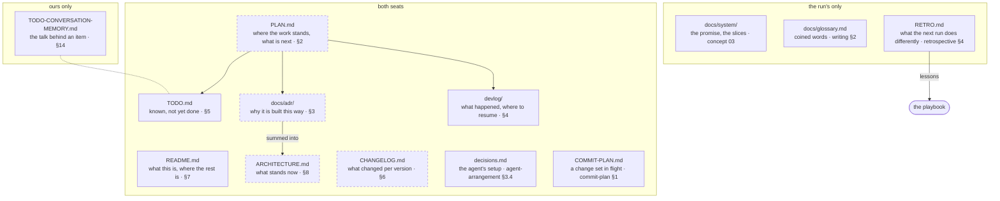

<!-- A visual-comparison draft for the records map, project-recording
     §1 (the commit plan for the records map, commits 2 to 4). Data
     only: how it is worked is `visual-comparison`. Deleted when
     ADR-0067 records the outcome; git keeps it. -->

# The records map: a comparison

## The defect

What each record holds is told in four places that differ:
`CLAUDE.md`'s records table, `README.md`'s "What it answers" column,
`ARCHITECTURE.md`'s codemap and `temp/README.md` (round 2's
FINDING-145). For the devlog, README says "open questions" and
`CLAUDE.md` "a TODO item's story". No text shows both seats' records
side by side. The refinement's DECISION-12 makes project-recording
§1 the overview each seat's table and the README derive from.
Refined by the reviewer on 2026-10-26: the map is a summary, home
to nothing. Each row points at the home of its fact: the record's
section in project-recording, or its owner's manual; how the seats
differ stays in project-recording's *The seats*.

## The records

Thirteen, from the stubs, both entry files' tables and
project-recording:

- **both seats:** `README.md`, `PLAN.md`, `TODO.md`,
  `CHANGELOG.md`, `ARCHITECTURE.md`, `docs/adr/`, `devlog/`,
  `.claude/decisions.md` (agent-arrangement's), `COMMIT-PLAN.md`
  (commit-plan's), when present;
- **the run's only:** `docs/system/` and `docs/glossary.md`, both
  the method's, from framing; `RETRO.md` (the retrospective's),
  when present;
- **ours only:** `TODO-CONVERSATION-MEMORY.md`, on trial.

## Requirements

What a reader of the map must get. Each can fail.

1. **What each record answers,** a line each, with a fact
   reference to where its full what and why live: its section in
   project-recording, or the manual of the convention or method
   that owns it.
2. **Which seats keep it:** both, ours only, or the run's only, for
   every record, without reading a seat's section.
3. **Where the seats differ,** the row says so and points at where
   the difference is stated, project-recording's *The seats*. Seven
   differences today.
4. **Every record,** the thirteen above, with the convention or the
   method that owns it where that is not project-recording.
5. **Which record answers a question:** a reader holding "where is
   the why of X recorded?" finds the record from the question.
6. **How the records feed each other** where it matters: the plan
   as the spine, a decision summarized into the map of the system,
   the lessons folding back into the playbook. Today's §1 picture
   carries this.
7. **No moment and no how:** when a record is opened is each seat's
   table's (§13), and how it is written is its form's. The map
   holds neither, so it is no second home for them.
8. **One view:** all thirteen readable without scrolling past one
   screen, about 40 lines.
9. **Plain text that renders** on GitHub and in the IDE with no
   build step, and reads in a diff.
10. **It says it is a summary,** and names its owners, so nobody
    reads it in their place (`.claude/rules/one-home.md`, rule 3).

## Candidates

Each built in full, as it would stand in project-recording §1. Its
fact references are written short here: a bare § is
project-recording's; another manual is named by its convention.

### A. A table, with the relations in one sentence

A summary: each row's home holds the record's full what and why.
"Differs" means the seats keep it differently; *The seats* says how.

| Record | What it answers | Seats | Its home |
|---|---|---|---|
| `README.md` | what this is, how to use it, where the rest is | both | §7 |
| `PLAN.md` | where the work stands, what is next, what *done* means | both, differs | §2 |
| `TODO.md` | what is known and not yet done | both | §5 |
| `docs/adr/` | why it is built this way | both, differs | §3 |
| `devlog/` | what happened, the dead ends, where to resume | both | §4 |
| `ARCHITECTURE.md` | what stands now, and how its parts tie | both, differs | §8 |
| `CHANGELOG.md` | what changed in each version, for whoever pins it | both, differs | §6 |
| `.claude/decisions.md` | how the agent's setup was decided | both | agent-arrangement §3.4 |
| `COMMIT-PLAN.md` | the commits of a change set in flight, when present | both | commit-plan §1 |
| `docs/system/` | what is promised, what must never happen, the slices | the run's | the concept, chapter 03 |
| `docs/glossary.md` | what each coined word means | the run's; ours is `ARCHITECTURE.md`'s *The words* | writing §2, rule 6 |
| `RETRO.md` | what the next run does differently, when present | the run's | retrospective §4 |
| `TODO-CONVERSATION-MEMORY.md` | the talk behind a TODO item | ours, on trial | §14 |

The plan is the spine: decisions, the devlog and TODO hang off its
steps; the ADRs are summed into `ARCHITECTURE.md`; a run's lessons
reach the playbook through `RETRO.md`.

### B. A numbered list, by seat

A summary: each record's home holds its full what and why. Where
the seats keep a record differently, *The seats* says how.

**Both seats**

1. `README.md`: what this is, how to use it, where the rest is (§7).
2. `PLAN.md`: where the work stands, what is next, what *done*
   means (§2). Differs.
3. `TODO.md`: what is known and not yet done (§5).
4. `docs/adr/`: why it is built this way (§3). Differs.
5. `devlog/`: what happened, the dead ends, where to resume (§4).
6. `ARCHITECTURE.md`: what stands now, and how its parts tie (§8).
   Differs.
7. `CHANGELOG.md`: what changed in each version, for whoever pins
   it (§6). Differs.
8. `.claude/decisions.md`: how the agent's setup was decided
   (agent-arrangement §3.4).
9. `COMMIT-PLAN.md`: the commits of a change set in flight, when
   present (commit-plan §1).

**The run's only**

10. `docs/system/`: what is promised, what must never happen, the
    slices (the concept, chapter 03).
11. `docs/glossary.md`: what each coined word means (writing §2,
    rule 6). Ours is `ARCHITECTURE.md`'s *The words*.
12. `RETRO.md`: what the next run does differently, when present
    (retrospective §4).

**Ours only**

13. `TODO-CONVERSATION-MEMORY.md`: the talk behind a TODO item, on
    trial (§14).

The plan is the spine: decisions, the devlog and TODO hang off its
steps; the ADRs are summed into `ARCHITECTURE.md`; a run's lessons
reach the playbook through `RETRO.md`.

### C. A Mermaid picture

A summary: each record's home holds its full what and why. A dashed
border means the seats keep it differently; *The seats* says how.



### D. Unicode box drawing

A summary: each record's home holds its full what and why.
`both*`: the seats keep it differently; *The seats* says how.

```
 PLAN.md ─ where the work stands, what is next ─── §2   both*
   │  its steps feed:
   ├─ docs/adr/   why it is built this way ─────── §3   both*
   │     └─► summed into ARCHITECTURE.md ───────── §8   both*
   ├─ devlog/     what happened, where to resume ── §4   both
   └─ TODO.md     known, not yet done ───────────── §5   both
         └─ TODO-CONVERSATION-MEMORY.md, the talk §14   ours
 CHANGELOG.md   what changed per version ───────── §6   both*
 README.md      what this is, where the rest is ─── §7   both
 .claude/decisions.md  the agent's setup ── agent-arrangement §3.4  both
 COMMIT-PLAN.md  a change set in flight ── commit-plan §1         both
 docs/system/    the promise, the slices ── the concept, 03       run
 docs/glossary.md  coined words ── writing §2, rule 6             run
 RETRO.md   what the next run does differently ── retrospective §4  run
     └─► its lessons reach the playbook
```

### E. Today's §1 picture

As it stands in project-recording §1 at the start of this plan,
unchanged:

```
                    PLAYBOOK  (reusable, lives across projects)
                       │  steps at birth         ▲  fold lessons back
                       ▼                         │
   ┌────────────────  PLAN.md  (the spine) ──────┴─────────────┐
   │  Step 1 [x] ── Step 2 [~] ── Step 3 [ ] ── ... ── Retro   │
   └───┬──────────────┬────────────────┬────────────────┬──────┘
       │              │                │                │
   forced a       daily work      found new        step shipped
   decision       inside step     non-blocking     something
       │              │           work │               │
       ▼              ▼                ▼               ▼
     ADR           DEVLOG           TODO          CHANGELOG
  (why we        (what we        (what's not     (what changed,
   chose X)       tried, what     done yet)       for users)
                  failed)
       │
       └──► summarized into ARCHITECTURE.md (current state of the system)

   README.md = the front door: what this is, how to run it, where the
               other records are.
```

### F. The list B, with a picture for each seat

The reviewer's pairing, 2026-10-26. B as it stands, without its
closing sentence, then one picture per seat. The arrows say what a
record holds for the plan, not when it is written: the moment is
each seat's records table's (requirement 7).

*The run's seat:*

```
                    PLAYBOOK  (the deliverer's; a run holds none)
                       │  steps, at birth         ▲  lessons fold back,
                       ▼                          │  through RETRO.md
   ┌────────────────  PLAN.md  (the spine) ───────┴────────────┐
   │  Step 0 [x] ── Step 1 [~] ── Step 2 [ ] ── ... ── Retro   │
   └───┬──────────────┬────────────────┬────────────────┬──────┘
       │              │                │                │
      why       what happened     not yet done     what changed
       │              │                │                │
       ▼              ▼                ▼                ▼
      ADR          DEVLOG             TODO          CHANGELOG
       │                                           (for users)
       └──► summed into ARCHITECTURE.md (the system as it stands)

   docs/system/ = what is promised, the slices
   README.md    = the front door: what this is, where the rest is
```

*Our seat:*

```
   ┌───────────────  PLAN.md  (the spine) ───────────────┐
   │  the one step being worked, and any step it stopped │
   └───┬──────────────┬────────────────┬────────────┬────┘
       │              │                │            │
      why       what happened     not yet done  what changed
       │              │                │            │
       ▼              ▼                ▼            ▼
      ADR          DEVLOG             TODO      CHANGELOG
       │                               ┊      (the concept's versions)
       │              TODO-CONVERSATION-MEMORY.md (the talk behind an item)
       └──► summed into ARCHITECTURE.md (documents and delivery)

   Lessons fold back at each step's close: into the conventions,
   the playbook, the concept.
   README.md = the front door: what this is, where the rest is
```

## Verdicts

Every verdict is a **prediction** until the reviewer renders the
candidates on GitHub and in the IDE. P passes, F fails, ~ holds
only in part.

| Requirement | A table | B list | C Mermaid | D box | E today | F list + two pictures |
|---|---|---|---|---|---|---|
| 1. what each answers, with its home | P | P | ~ labels cut short | ~ cut short | F no homes | P |
| 2. which seats keep it | P | P | P | P | F | P |
| 3. where the seats differ | P | P | ~ a dash, not words | ~ a mark | F | P the pictures show it too |
| 4. every record, with its owner | P | P | P | P | F 7 of 13 | P |
| 5. a record from a question | P one column to scan | ~ prose to scan | F a picture to search | ~ | ~ | ~ prose to scan |
| 6. how the records feed each other | ~ one sentence | ~ one sentence | P | P | P | P |
| 7. no moment, no how | P | P | P | P | F "daily work" | P |
| 8. one view, about 40 lines | P 19 | P 31 | ~ tall when rendered | P 18 | P 21 | F about 65 |
| 9. renders, reads in a diff | P | P | ~ IDE needs Mermaid on | P | P | P |
| 10. says it is a summary | P | P | P | P | F | P |

Predicted: A, the table. It is the only candidate with no F and
no ~ but on relations, which its one sentence carries. D is the
best picture, and loses on 1 and 3: a line cut to fit a column says
less than a cell.

For the reviewer to settle by rendering: A against D, and whether C
renders in the IDE at all.

The reviewer leans to F, 2026-10-26: B for which record answers
what, and a picture per seat for how the records feed each other,
since a reader holds one seat at a time. F fails requirement 8: at
about 65 lines it is no single screen. Either 8 is struck, as a
requirement the chosen answer shows too narrow, or F loses to A.
