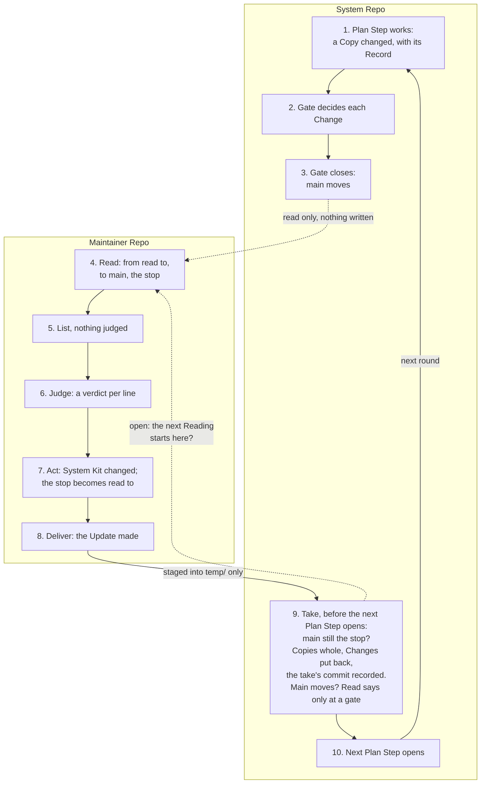
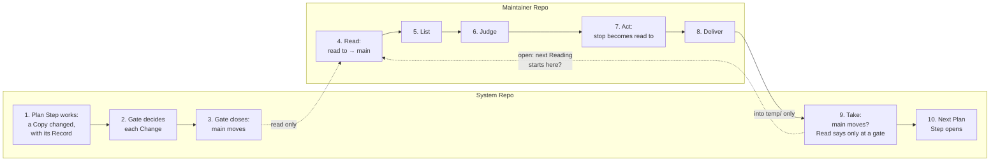
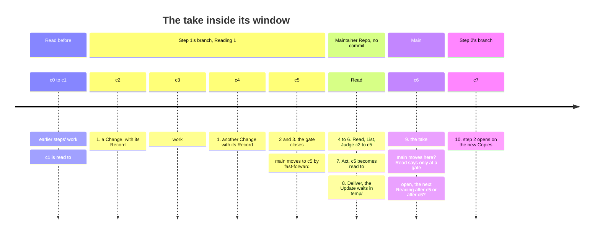

# A System Repo's Change, as a Flow

<!-- A draft for the Plan Step "Find how what we know stays true",
     stage 1. It pictures the whole round of
     temp/system-repo-change-simulation.md. The facts live in the
     simulation, never here. "Now" pictures the simulation as it is.
     "After" pictures one open decision, one drawing per option, each
     named by its option. When the decision is made, the simulation
     changes, the chosen option's drawing becomes "Now", and "After"
     is emptied. B1 and B2 are two forms of one picture, both kept
     until one reads better. It goes when the Plan Step closes, and
     git keeps every version. -->

It uses the simulation's short words: Change, Record, Copy, Update, Update Note, Version, Reading, Register (`temp/system-repo-change-simulation.md`, its table at the top).

## 1. What the reader must get

Each drawing is checked against these.

1. **R1, the order:** every step of one round, from a Change to the next Plan Step opening.
2. **R2, the repo:** which repo each step happens in.
3. **R3, what crosses:** a Reading only reads the System Repo, and writes nothing there. An Update is written only into the System Repo's `temp/`.
4. **R4, where main moves:** each place main moves.
5. **R5, where a Reading reads:** where each Reading starts and stops.
6. **R6, what is open:** each part not decided is marked open, and nothing decides it.

## 2. Now

The take moves main, but Read says main moves only at a gate's close (`temp/system-repo-change-simulation.md` §4, step 1, *Where a stretch ends*). That is found item 1 (devlog 2026-11-12).

### B1, two boxes, top to bottom



### B2, two rows, left to right



### The System Repo's commits

Imaginary commits of the System Repo, oldest first, top to bottom. The left column is main; a step's branch is cut from main and drawn to its right. The middle column marks the commits a Reading reads. The round's parts, numbered as above, point at the commit they act on. A dotted line is no commit. At a gate's close, main moves to the branch's last commit by fast-forward: a commit named again on main is main moving to it, not a new commit.

#### Picture 1, the take inside its window

```
 main      branches                       read                parts
 ────      ────────                       ────                ─────
 c0 ●  earlier steps' work                ┐ read
    │                                     │ before
 c1 ●  the last stop                      ┘             ◀──── read to: where the last Reading stopped
    │
    ├─ cut ─▶ c2 ●  a Change, its Record  ┐             ◀──── 1. a Change, with its Record, on step 1's branch
    │            │                        │ Reading 1
    │         c3 ●  work                  │ reads
    │            │                        │ c2 to c5
    │         c4 ●  a Change, its Record  │             ◀──── 1. another Change, with its Record
    │            │                        │
    │         c5 ●  the gate closes       ┘             ◀──── 2, 3. the gate decides each Change, and closes
    │            │
 c5 ● ◀──────────┘                                      ◀──── main moves to c5 by fast-forward, no new commit
    │                                                   ◀──── 4 to 6. Read, List, Judge: c2 to c5, the whole span
    │                                                   ◀──── 7. Act: c5 becomes read to
    ┊                                                   ┄┄┄┄┄ 8. Deliver: no commit; the Update waits in temp/
    │
 c6 ●  the take, made on main                           ◀──── 9. Take: main is still c5, so it runs
    │                                                   ◀──── main moves here? Read says only at a gate
    │                                                   ◀┄┄┄┄ open: next Reading after c5, or after c6?
    │
    └─ cut ─▶ c7 ●  step 2's work                       ◀──── 10. step 2 opens on the new Copies
```

#### Picture 2, the window missed

Step 2 opened before the take: the human started it before the Update came, or postponed the take (`temp/system-repo-change-simulation.md` §8, step 1, *A postponed take*).

```
 main      branches                       read                parts
 ────      ────────                       ────                ─────
 c0 ●  earlier steps' work                ┐ read
    │                                     │ before
 c1 ●  the last stop                      ┘             ◀──── read to: where the last Reading stopped
    │
    ├─ cut ─▶ c2 ●  a Change, its Record  ┐             ◀──── 1. a Change, with its Record, on step 1's branch
    │            │                        │ Reading 1
    │         c3 ●  work                  │ reads
    │            │                        │ c2 to c5
    │         c4 ●  a Change, its Record  │             ◀──── 1. another Change, with its Record
    │            │                        │
    │         c5 ●  the gate closes       ┘             ◀──── 2, 3. the gate decides each Change, and closes
    │            │
 c5 ● ◀──────────┘                                      ◀──── main moves to c5 by fast-forward, no new commit
    │                                                   ◀──── 4 to 7. Read, List, Judge, Act: c2 to c5;
    │                                                         c5 becomes read to
    │
    └─ cut ─▶ c6 ●  work, old Copies      ┐             ◀──── 10. step 2 opened before the take
                 ┊                        │             ┄┄┄┄┄ 8. Deliver: no commit; the Update waits in temp/
              c7 ●  a Change, its Record  │ read again  ◀──── 1. a Change, with its Record, on step 2's branch
                 │                        │ c6 to c8
              c8 ●  the gate closes       ┘             ◀──── 2, 3. the gate decides each Change, and closes
                 │
 c8 ● ◀──────────┘                                      ◀──── main moves to c8 by fast-forward, no new commit
                                                        ┄┄┄┄┄ 9. Take: main is c8, not c5, so it is refused; no commit
                                                        ┄┄┄┄┄ 4 again. Read: c6 to c8; a new Update replaces the waiting one
```

### Other ways to picture the commits

Picture 1 again, the take inside its window, drawn four other ways, to compare with the one above.

#### Way 1, time left to right

Parts above the commits, Readings below.

```
                  read to                                                                        the stop       9. the take
                     ▼                                                                              ▼               ▼
 main     c0 ─────── c1 ─────────────────────────────────────────────────────────────────────────── c5 ──────────── c6 ──────────────────────
                      │                                                                              ▲               │
 branches             └─ cut ─────c2────────────c3────────────c4────────────c5──fast-forward─────────┘               └─ cut ─────── c7
                                  ▲                           ▲             ▲                                                       ▲
                                  1. a Change                 1. a Change   2, 3. the gate                                          10. step 2
                                                                            closes                                                  opens

          └─ read before ─┘       └───────────── Reading 1: c2 to c5 ────────┘


 between c5 and c6, in the Maintainer Repo: 4 to 6. Read, List, Judge · 7. Act: c5 becomes read to · 8. Deliver
 at c6: main is still c5, so the take runs · main moves here? Read says only at a gate
 open: does the next Reading start after c5, or after c6?
```

#### Way 2, three lanes

The Maintainer Repo gets a lane of its own, above the System Repo's.

```
 Maintainer Repo                                                                    4 to 6. Read, List, Judge ─ 7. Act ─ 8. Deliver┐
                                                                                 ▲ read only, c2 to c5                             │ into temp/
                                                                                 │                                                 ▼ 9. the take
 System Repo main   c0 ──── c1 ──────────────────────────────────────────────── c5 ────────────────────────────────────────────── c6 ────────────────────
                             │                                                   ▲                                                 │
 System Repo branches        └──────────c2──────c3──────c4──────c5──ff───────────┘                                                 └─────────── c7
                                        1               1       2, 3                                                                            10

 numbers: the round's parts · ff: main moves to c5 by fast-forward · c0 to c1 read before, c1 is read to
 at c6: main moves here? Read says only at a gate · open: does the next Reading start after c5, or after c6?
```

#### Way 3, a table

| Commit | Where | What happens | Reading |
|---|---|---|---|
| c0 | main | earlier steps' work | read before |
| c1 | main | the last stop | *read to* |
| c2 | step 1's branch | 1. a Change, with its Record | Reading 1 |
| c3 | step 1's branch | work | Reading 1 |
| c4 | step 1's branch | 1. another Change, with its Record | Reading 1 |
| c5 | step 1's branch, then main | 2, 3. the gate decides each Change, and closes; main moves to c5 by fast-forward | Reading 1 stops here |
| no commit | Maintainer Repo | 4 to 6. Read, List, Judge: c2 to c5. 7. Act: c5 becomes *read to*. 8. Deliver: the Update waits in `temp/` | |
| c6 | main | 9. the take: main is still c5, so it runs. Main moves here? Read says only at a gate | open: does the next Reading start after c5, or after c6? |
| c7 | step 2's branch | 10. step 2 opens on the new Copies | |

#### Way 4, a Mermaid timeline


