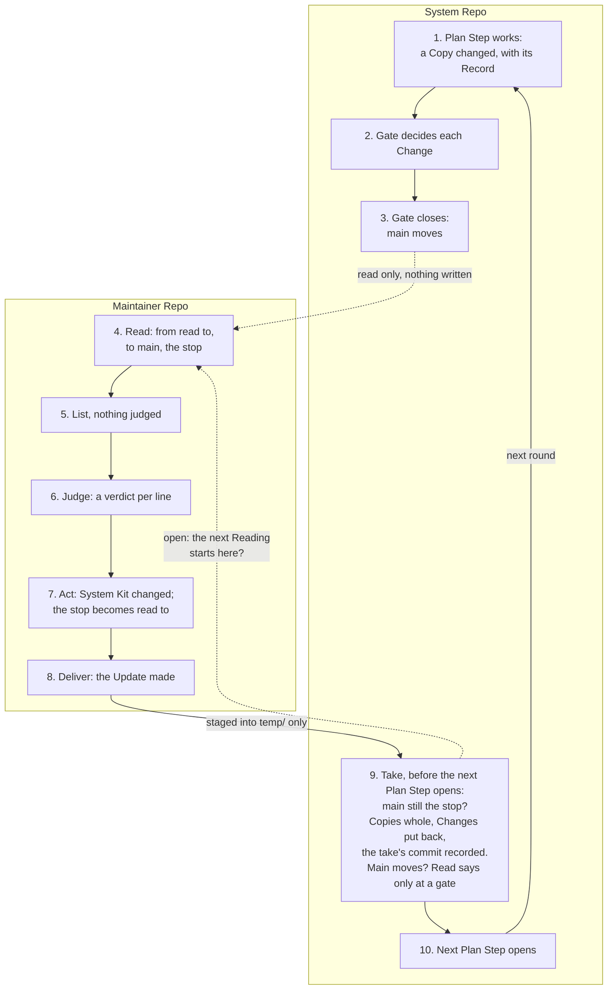
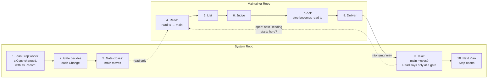
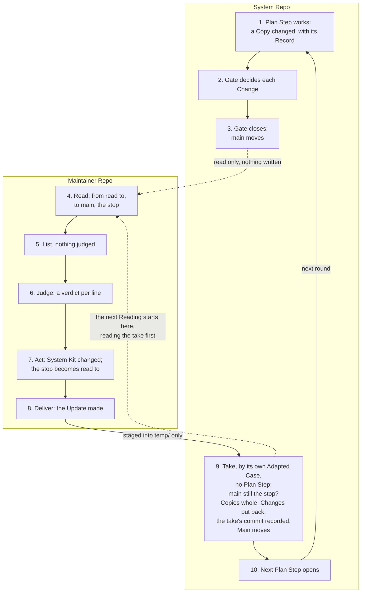
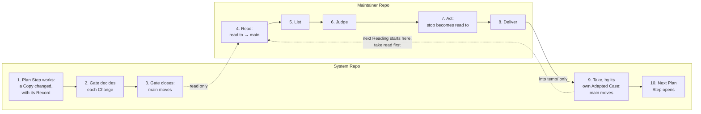
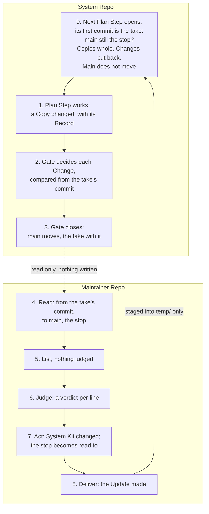
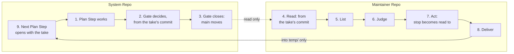
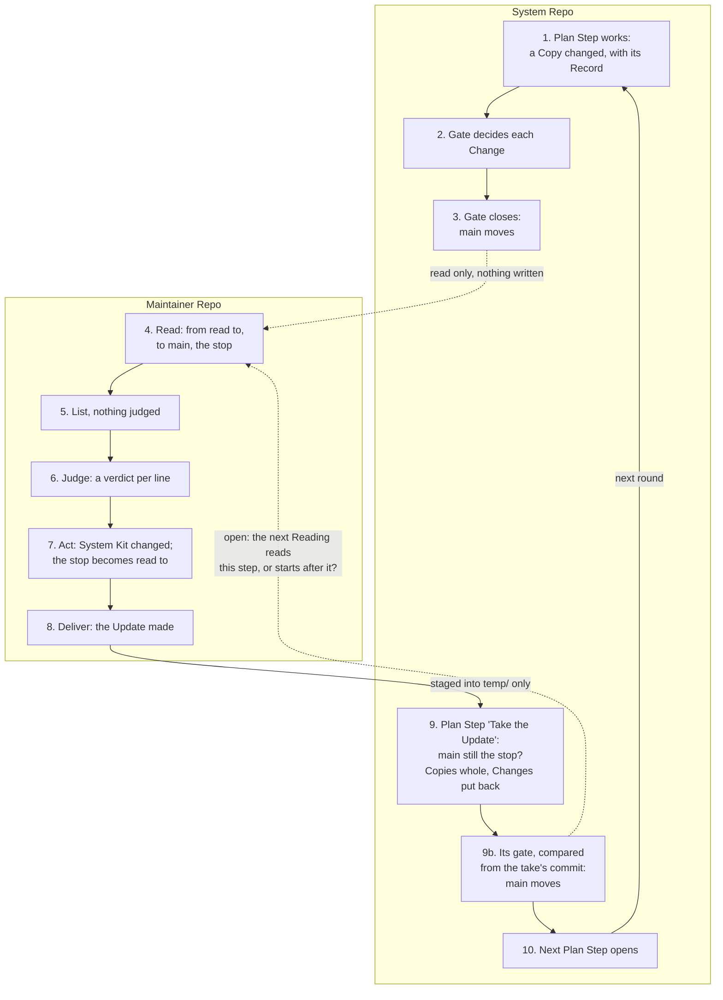
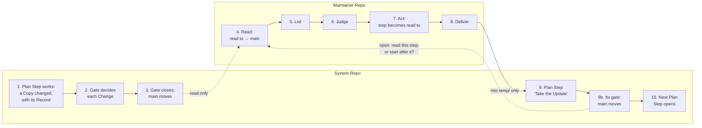

# A System Repo's Change, as a Flow

<!-- A draft for the Plan Step "Find how what we know stays true",
     stage 1. It pictures the whole round of
     temp/system-repo-change-simulation.md. The facts live in the
     simulation, never here. "Now" pictures the simulation as it is.
     "After" pictures one open decision, one drawing per option, each
     named by its option. When the decision is made, the simulation
     changes, the chosen option's drawing becomes "Now", and "After"
     is emptied. B1 and B2 are two forms of one picture, both kept
     until one reads better. It goes when the Plan Step closes, and
     git keeps every version. -->

It uses the simulation's short words: Change, Record, Copy, Update, Update Note, Version, Reading, Register (`temp/system-repo-change-simulation.md`, its table at the top).

## 1. What the reader must get

Each drawing is checked against these.

1. **R1, the order:** every step of one round, from a Change to the next Plan Step opening.
2. **R2, the repo:** which repo each step happens in.
3. **R3, what crosses:** a Reading only reads the System Repo, and writes nothing there. An Update is written only into the System Repo's `temp/`.
4. **R4, where main moves:** each place main moves.
5. **R5, where a Reading reads:** where each Reading starts and stops.
6. **R6, what is open:** each part not decided is marked open, and nothing decides it.

## 2. Now

The take moves main, but Read says main moves only at a gate's close (`temp/system-repo-change-simulation.md` §4, step 1, *Where a stretch ends*). That is found item 1 (devlog 2026-11-12).

### B1, two boxes, top to bottom

### B2, two rows, left to right

## 3. After, item 1

The question: where does the take happen, so that neither the gate nor the next Reading counts the Update as the System Repo's own work? Only the System Repo's side changes; steps 4 to 8 stay as they are.

### Option a, a take of its own

The take is run by its own Adapted Case, an Agent Skill or an Agent Rule, with no Plan Step. Its own check is its gate. Main moves at a gate's close or at a take. The next Reading starts at the take's commit, and reads the take by itself first.

#### B1

#### B2

### Option b, the next Plan Step's first commit

The take is the first commit of the next Plan Step, on its branch. Main moves only at a gate's close, so the take reaches main with that step's work. Its gate, and the next Reading, compare from the take's commit, not from where the step began or from *read to*.

#### B1

#### B2

### Option c, a Plan Step of its own

The take is a Plan Step, "Take the Update", with a full gate. Main moves only at a gate's close. Its gate compares from the take's commit, or it would count the whole Update as Changes. Whether the next Reading reads that Plan Step as work, or starts after it, stays open.

#### B1

#### B2

